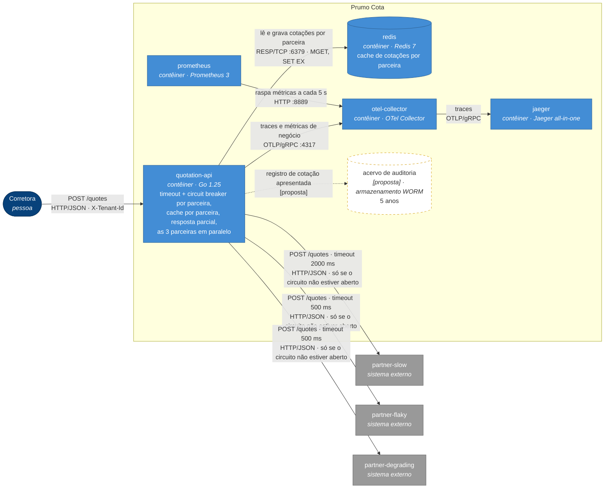
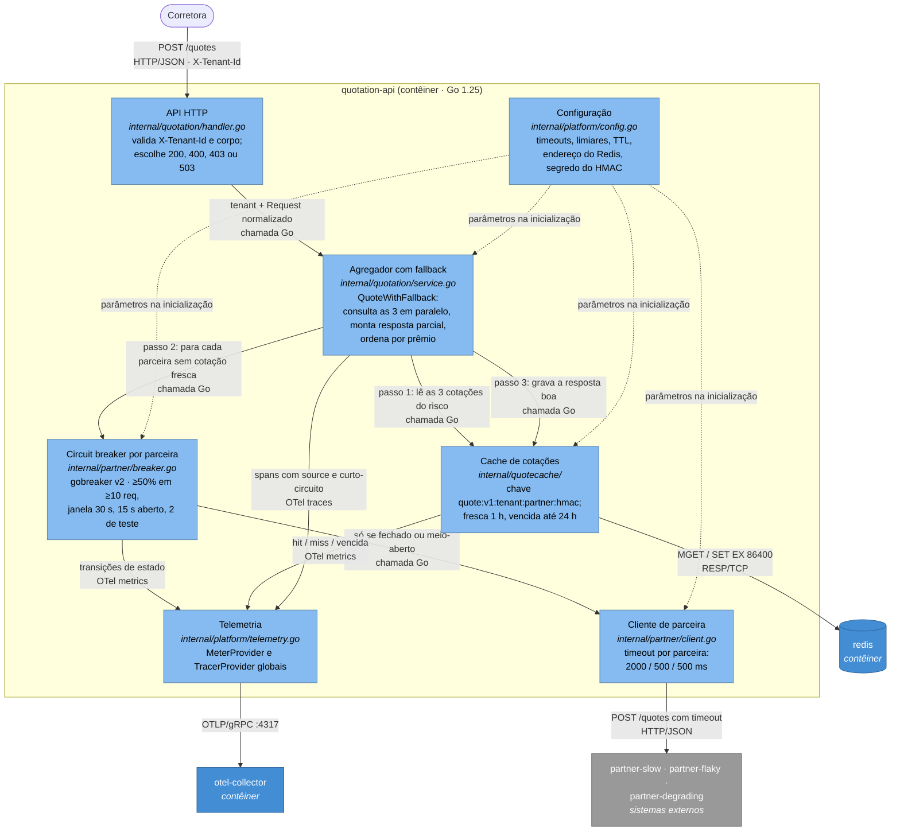

# SAD — Prumo Cota: resiliência na fronteira com as seguradoras

*Solution Architecture Document* da plataforma de cotação de seguro auto da Prumo Tecnologia em Seguros, depois da intervenção que protege a fronteira com as seguradoras parceiras.

| | |
|---|---|
| **Versão** | 1.0 — as oito seções, com os números medidos do PoC ([evidencias/depois.md](evidencias/depois.md)). |
| **Data** | 2026-10-27 (escrito a partir de 2026-10-26) |
| **Autor** | Guilherme A. Furmankiewicz |
| **Base** | repositório deste fork, branch `development`; enunciado em [enunciado.md](enunciado.md) |
| **Evidências** | [evidencias/](evidencias/) — o "antes" está em [evidencias/antes.md](evidencias/antes.md) |

**Convenção de rastreabilidade.** Todo caminho citado existe no repositório, salvo quando marcado como **[proposta]**, que é o que será criado na Entrega 2 (PoC) ou que fica só no papel. Números sem fonte não aparecem: cada um aponta para uma medição em `docs/evidencias/`, para o enunciado ou para o código.

---

## 1. Introdução

### 1.1 Propósito

Este documento sustenta **uma decisão**: como proteger a cotação agregada do Prumo Cota contra a instabilidade das três seguradoras parceiras, usando timeout, circuit breaker, cache e fallback na fronteira com elas, e quanto isso custa e economiza.

Ele é escrito para três leitores:

| Leitor | O que procura aqui | Onde está |
|---|---|---|
| **CTO da Prumo** | se o gasto se paga e em quanto tempo | §1.5 (pressupostos), §8 |
| **Plantonista** (quem opera às 3h) | o que olhar, qual limiar, o que fazer | §4 (comportamento), §6, §7 |
| **Encarregado de dados e auditoria** | como provar à ANPD que uma corretora nunca vê o dado de outra, e à SUSEP que a cotação servida de cache é rastreável | §4.3 (chave e descarte), §4.4 (contrato), §7 |

### 1.2 Escopo

**Dentro:** a `quotation-api` e a sua **fronteira** com as seguradoras — o cliente HTTP (`internal/partner/client.go`), a agregação (`internal/quotation/service.go`), o contrato de resposta (`internal/quotation/request.go`), o cache em Redis e a instrumentação de negócio.

**Fora:** o motor de precificação das seguradoras (a Prumo não precifica), o CRM e o front-end das corretoras, cadastro de corretoras, cobrança, autenticação, e os padrões que o enunciado declara fora de escopo (retry com backoff, bulkhead, rate limiting, fila, Kubernetes). Esses aparecem neste documento só como limite ou proposta, nunca como implementação.

### 1.3 Restrições (impostas — não são escolhas deste documento)

| # | Restrição | Origem |
|---|---|---|
| R1 | Go 1.25, Docker com Compose v2, Redis como cache, OpenTelemetry com o SDK já inicializado, Mermaid nos diagramas | enunciado, "Tecnologias obrigatórias" |
| R2 | Ambiente local, sem conta em cloud e sem custo | enunciado, "Suba o ambiente" |
| R3 | Três parceiras com comportamento fixo e determinístico (`cmd/partner-mock/`), que não podem ser alteradas | enunciado, "Restrições" |
| R4 | Cobrança de R$ 0,04 por consulta à seguradora, não por venda | enunciado, "O cenário" |
| R5 | A Prumo é **operadora** de dados pessoais (LGPD); a corretora é controladora; uso cruzado entre corretoras é proibido | enunciado, "O que a regulação impõe" |
| R6 | Toda cotação apresentada é auditável por **5 anos**, sem regravação (SUSEP), inclusive a servida de cache ou de fallback | enunciado, "O que a regulação impõe" |
| R7 | Prêmio vem sempre de uma parceira ou de cache rastreável; a plataforma nunca calcula prêmio | enunciado, "Restrições" |
| R8 | As seguradoras honram o prêmio por até **24 h** (teto comercial) | enunciado, "O cenário" |
| R9 | Os testes que já vêm no repositório continuam verdes | enunciado, "Restrições" |

### 1.4 Decisões (escolhas deste documento, defendidas na §4)

Timeout por parceira (D1), biblioteca e escopo do breaker (D2, D3), política de disparo (D4), granularidade do cache (D5), TTL e política de vencimento (D6), chave do cache (D7), estratégia de fallback (D8), onde o fallback vive no código (D9), contrato da resposta degradada (D10); e, nas seções 5 a 7, onde a plataforma roda (D11), RTO e RPO por classe de dado (D12), os alertas (D13), o breaker com pouco tráfego como limite conhecido (D14) e o caminho de mudança do TTL (D15); e, como bônus, a agregação paralela (D16, §4.8). O estudo das opções está em [estudo-decisoes.md](estudo-decisoes.md) (D1 a D10) e em [estudo-decisoes-1b.md](estudo-decisoes-1b.md) (D11 a D15).

### 1.5 Pressupostos

Cada pressuposto tem valor, origem e o que muda se ele for falso.

| # | Pressuposto | Valor | Origem | Consequência se for falso |
|---|---|---|---|---|
| **P1** | **Recotação na mesma corretora:** fração das cotações que repetem o mesmo risco (mesmo motorista, veículo e cobertura), **na mesma corretora**, em até 1 h da anterior | **40%** | Estimativa. O enunciado afirma que "o corretor recota a mesma placa várias vezes na mesma conversa", sem número. Não há dado de produção; a métrica de hit rate do cache (§4.5) é o instrumento para medi-lo. | É o hit rate da §8. Se for **10%**, a economia de consultas cai de ≈ R$ 127 mil/mês para ≈ R$ 32 mil/mês e o veredito de payback da §8 precisa ser refeito. A recotação **entre corretoras** não conta: a chave do cache tem a corretora (§4.3). |
| **P2** | **Latência das parceiras em repouso** | slow ≤ 1700 ms · flaky ≤ 200 ms · degrading ≤ 160 ms | `docker-compose.yml` e `cmd/partner-mock/behavior.go` (latência + jitter); confirmado no trace do "antes" ([evidencias/antes.md](evidencias/antes.md), evidência 3) | Os timeouts da §4.1 são derivados destes valores. Se a `partner-slow` passar de 2 s em repouso, **toda** chamada a ela estoura e o breaker dela fica aberto o tempo todo: a parceira some das respostas por decisão nossa. Os timeouts precisam ser recalibrados com o p99 real de cada parceira. |
| **P3** | **Ritmo de produção:** 120.000 cotações por dia útil concentradas em 10 h de horário comercial | ≈ 3,3 cotações/s, ou seja ≈ 3,3 chamadas/s por parceira sem cache | Volume do enunciado ("O cenário"); a janela de 10 h é estimativa | Dimensiona a janela do breaker (§4.2): com 3,3 chamadas/s, o mínimo de 10 requisições é atingido em ≈ 3 s. Se o tráfego for muito mais espalhado (24 h), o mínimo demora mais para ser atingido e o breaker reage mais devagar. |
| **P4** | **Validade comercial do prêmio** | 24 h | Enunciado (R8) | A cotação vencida servida no fallback (§4.3, até 24 h) passaria a ser preço não honrado. A janela de vencida teria de cair para o `valid_for_seconds` devolvido pela parceira (300 s no mock). |
| **P5** | **Custo da empresa por pessoa** | 1,7 × a remuneração total (R$ 35.171/mês para um sênior) | Estimativa de encargos e benefícios sobre a mediana do Levels.fyi (§8.4) | Com 2,0×, o payback da §8 vai de 0,94 para 1,13 mês (20%) e de 0,44 para 0,53 mês (P1): o veredito não muda. |
| **P6** | **Tamanho do registro de auditoria** | 1 KB por cotação apresentada | Estimativa pelo formato da `Response` (§4.4): corretora, instante e as cotações com parceira, `quote_id`, prêmio, origem e idade | O armazenamento é tão barato (R$ 352 no ano 5, §8.3) que nem 10× muda o veredito; muda a classe de armazenamento escolhida. |
| **P7** | **Corretoras ativas** | 300 | Enunciado: "algumas centenas em produção" | Muda só o número de gravações da auditoria em lote (§8.3), que custa centavos. |

---

## 2. Visão geral da arquitetura

### 2.1 Contexto (C4 nível 1)

A Prumo **intermedeia**: recebe o pedido da corretora, consulta as seguradoras e devolve as propostas. Ela não precifica.


No ambiente deste repositório, as seguradoras A, B e C são os contêineres `partner-slow`, `partner-flaky` e `partner-degrading` (`cmd/partner-mock/`).

### 2.2 Contêineres — antes (C4 nível 2)

Como o sistema está no commit de partida, conforme `docker-compose.yml`.


O que o diagrama mostra, e que foi medido ([evidencias/antes.md](evidencias/antes.md)): a latência é a **soma** das três (trace de 8,05 s, dos quais 6,1 s na `partner-degrading`), e uma falha da `partner-flaky` derruba a cotação inteira (502, com o span da `partner-degrading` ausente).

### 2.3 Contêineres — depois (C4 nível 2)



### 2.4 O delta

| Tipo | O que muda | Onde |
|---|---|---|
| **Acrescenta** | timeout por parceira | `internal/partner/client.go` e `internal/platform/config.go` |
| **Acrescenta** | circuit breaker por parceira (gobreaker v2) | `internal/partner/breaker.go` |
| **Acrescenta** | cache por parceira em Redis | pacote novo `internal/quotecache/` (`key.go`, `redis.go`) |
| **Acrescenta** | resposta parcial e campos de degradação no contrato | `internal/quotation/service.go`, `internal/quotation/request.go`, `internal/quotation/handler.go` |
| **Acrescenta** | agregação paralela no caminho com fallback (bônus, §4.8) | `internal/quotation/service.go` |
| **Acrescenta** | métricas e marcações de trace de negócio | `internal/partner/metrics.go`, `internal/quotation/telemetry.go` |
| **Muda de papel** | o `redis` deixa de ser um contêiner ocioso e passa a ser dependência da API (não obrigatória: sem ele, a API funciona sem cache) | `docker-compose.yml`, `cmd/quotation-api/main.go` |
| **Muda de papel** | a resposta deixa de ser tudo-ou-nada: 502 só sai do caminho antigo, que fica preservado para os testes originais | `internal/quotation/service.go` |
| **Fica no papel** | acervo de auditoria de 5 anos | **[proposta]** — custo na §8, sem código (fora de escopo pelo enunciado) |
| **Não sai nada** | o Collector, o Jaeger, o Prometheus e as três parceiras continuam como estão | — |

**A quem esta arquitetura serve.** À corretora, que deixa de receber 502 quando uma das três parceiras falha e passa a receber o que existe, sabendo o que faltou. Ao CTO, porque cada consulta que o cache evita é R$ 0,04 a menos, e cada cotação que não morre no meio deixa de desperdiçar as consultas já pagas. Ao plantonista, que passa a ver o estado de cada parceira em vez de deduzi-lo de 502 genéricos. E ao encarregado de dados, porque o isolamento entre corretoras deixa de depender de cuidado e passa a estar na chave do cache.

---

## 3. Requisitos

### 3.1 Funcionais

Os RF-01 a RF-04 saem do contrato que já existe; os RF-05 a RF-09 são **criados por esta arquitetura**. Cada um é uma frase testável.

| ID | Requisito | Origem | Como se testa |
|---|---|---|---|
| RF-01 | `POST /quotes` sem o cabeçalho `X-Tenant-Id` responde **400** `{"error":"X-Tenant-Id is required"}`; com corretora fora de `TENANTS`, **403** `{"error":"broker not enabled on this platform"}`. | contrato atual, `internal/quotation/handler.go` | `internal/quotation/handler_test.go` |
| RF-02 | A resposta de sucesso lista as cotações **ordenadas por `premium_cents` crescente**, inclusive quando é degradada. | contrato atual, `internal/quotation/service.go`; enunciado, "Outras regras" | `TestQuoteAggregatesTheThreePartnersSortedByPremium` (original) e `TestOnePartnerDownGivesAPartialResponseInsteadOf502` (degradada), em `internal/quotation/` |
| RF-03 | O corpo inválido responde **400** com as mensagens de `Request.Normalize()`. | contrato atual, `internal/quotation/request.go` | `internal/quotation/request_test.go` |
| RF-04 | Toda cotação apresentada carrega a parceira, o prêmio, a corretora (`tenant_id`) e o `quote_id` **original** da parceira, inclusive quando vem do cache. | R6 (SUSEP) | `TestAFreshCachedQuoteDoesNotCallThePartner` e `TestASuccessfulAnswerIsSavedForTheBroker` (`internal/quotation/fallback_test.go`) |
| RF-05 | Quando uma parceira falha (erro, timeout ou circuito aberto) e as outras respondem, a API responde **200** com as cotações disponíveis, `"degraded": true` e a parceira ausente em `missing_partners`, com o motivo. | **nova** (D8) | `TestOnePartnerDownGivesAPartialResponseInsteadOf502`, `TestTheReasonSaysWhyThePartnerIsMissing` e `TestTheAPIWithFallbackAnswers200Degraded` (`internal/quotation/fallback_test.go`) |
| RF-06 | Uma cotação servida do cache vem com `"source": "cache"` e `age_seconds` (idade desde a consulta original); uma consultada agora vem com `"source": "partner"`. | **nova** (D6, D10) | `TestAFreshCachedQuoteDoesNotCallThePartner`, `TestAnExpiredQuoteIsOnlyServedWhenThePartnerFails` e `TestAQuoteOlderThan24hIsNeverServed` (`internal/quotation/fallback_test.go`) |
| RF-07 | Com o circuito de uma parceira **aberto**, a API **não faz** a chamada HTTP a ela; a parceira aparece em `missing_partners` com o motivo `circuit_open`, ou é preenchida pela cotação vencida do cache. | **nova** (D3, D4) | `TestBreakerOpensOnTheFlakySequenceAndStopsCallingThePartner` (`internal/partner/breaker_test.go`): a parceira não recebe nenhuma das 20 chamadas feitas com o circuito aberto |
| RF-08 | Se nenhuma parceira responder e não houver cotação no cache, a API responde **503** `{"error":"no partner insurer available","missing_partners":[...]}`, distinto do 502 atual. | **nova** (D8) | `TestNothingAvailableIsABusinessError` e `TestTheAPIWithFallbackAnswers503WhenNothingIsAvailable` (`internal/quotation/fallback_test.go`) |
| RF-09 | Uma cotação gravada para uma corretora **nunca** é servida a outra, mesmo com corpo idêntico. | **nova** (D7); R5 | `TestOneBrokerNeverReceivesTheCachedQuoteOfAnother` (`internal/quotation/fallback_test.go`) e `TestTheSameRiskIsADifferentKeyForEachBroker` (`internal/quotecache/quotecache_test.go`) |

### 3.2 Não funcionais

O "hoje" das linhas RNF-01, RNF-02, RNF-03 e RNF-04 foi medido com `make down && make reproduce` em 2026-10-26 ([evidencias/antes.md](evidencias/antes.md)); o da RNF-03 vem dos contadores do Prometheus dessa mesma execução. Todas as medições usam a carga padrão: 10 requisições de baseline e 200 com 50 em voo.

| ID | Requisito | Métrica | Hoje | Alvo | Como medir | Por que este número |
|---|---|---|---|---|---|---|
| RNF-01 | Latência da cotação sob carga | p95 do `POST /quotes`, fase de carga | **8,01 s** | **≤ 2,0 s** | relatório do `make reproduce`; em gráfico: `histogram_quantile(0.95, sum by (le) (rate(http_server_request_duration_seconds_bucket{http_route="/quotes"}[5m])))` | É o **teto estrutural** da agregação paralela (§4.8, D16): a cotação espera a parceira mais lenta, e o maior timeout da §4.1 é 2,0 s. Em série seria a soma, 2,0 + 0,5 + 0,5 = 3,0 s. Nenhuma requisição deveria passar disso, com ou sem cache. |
| RNF-02 | Cotações entregues | fração de respostas **200** (completas ou degradadas) na fase de carga | **60%** (120 de 200) | **≥ 99%** | relatório do `make reproduce` (`success`) | Com resposta parcial, só falha quando as três parceiras falham juntas e não há cache. A `partner-slow` nunca falha em repouso (P2), então esse caso é raro. |
| RNF-03 | Consultas compradas por cotação entregue | `sum(http_client_request_duration_seconds_count) / sum(http_server_request_duration_seconds_count{http_route="/quotes", http_response_status_code="200"})` | **4,36** (545 consultas para 125 entregues; [evidencias/consultas-antes.txt](evidencias/consultas-antes.txt)) | **≤ 1,8** em produção | consulta PromQL ao lado, no fim de cada execução | 3 consultas × (1 − 40% de hit rate do P1) = 1,8. O "hoje" acima de 3 é o desperdício do tudo-ou-nada: as consultas feitas antes de uma falha são pagas e jogadas fora. |
| RNF-04 | Vazão sob 50 em voo | requisições por segundo na fase de carga | **8,0 req/s** | **≥ 25 req/s** | relatório do `make reproduce` (`throughput`) | Lei de Little com 50 em voo e o teto de 2,0 s da RNF-01: 50 ÷ 2,0 = 25 req/s. |
| RNF-05 | Custo de uma parceira com circuito aberto | chamadas HTTP feitas a uma parceira enquanto o circuito dela está aberto | não existe breaker | **0** | trace da requisição curto-circuitada **sem** span `HTTP POST` para aquela parceira (evidência 3 da Entrega 2) | Aberto quer dizer que a chamada não sai (enunciado, Entrega 2 §1). Uma chamada feita e descartada não economiza os R$ 0,04 nem o tempo. |
| RNF-06 | Isolamento entre corretoras | respostas servidas do cache a uma corretora diferente da que gerou a entrada | 0 (não há cache) | **0**, sempre | teste determinístico do RF-09; inspeção do formato da chave (§4.3) | R5: uma resposta cruzada é incidente de dados pessoais com dever de notificação à ANPD. Não existe tolerância. |
| RNF-07 | Prazo máximo de guarda no cache | maior TTL restante de uma chave `quote:*` no Redis | não há cache | **≤ 86.400 s** (24 h) | `redis-cli --scan --pattern 'quote:*'` seguido de `TTL` em cada chave | P4 e LGPD: nada fica guardado além do teto comercial. O descarte é feito pelo próprio Redis, não por rotina manual. |

### 3.3 Hoje e depois, medidos

O "depois" foi medido com o PoC completo, com a mesma carga padrão ([evidencias/depois.md](evidencias/depois.md)).

| ID | Hoje | Depois | Alvo | Atingido? | Evidência |
|---|---|---|---|---|---|
| RNF-01 | 8,01 s | **202 ms** | ≤ 2,0 s | sim | [reproduce-depois.txt](evidencias/reproduce-depois.txt) |
| RNF-02 | 60% | **100%** | ≥ 99% | sim | [reproduce-depois.txt](evidencias/reproduce-depois.txt) |
| RNF-03 | 4,36 | **0,27** nesta carga | ≤ 1,8 em produção | sim, mas o 0,27 vem de uma carga que repete 5 cotações (91% de acerto); em produção o valor esperado é o do P1, 1,8 | [consultas-depois.txt](evidencias/consultas-depois.txt) |
| RNF-04 | 8,0 req/s | **730 req/s** | ≥ 25 req/s | sim; o laço fechado do gerador acelera quando a latência cai (roteiro §7) | [reproduce-depois.txt](evidencias/reproduce-depois.txt) |
| RNF-05 | não existia | **0** chamadas | 0 | sim: nenhum `HTTP POST` para as parceiras curto-circuitadas | [trace-depois-breaker-aberto-rapido.json](evidencias/trace-depois-breaker-aberto-rapido.json) |
| RNF-06 | 0 (sem cache) | **0** | 0 | sim | `TestOneBrokerNeverReceivesTheCachedQuoteOfAnother`, em [make-test.txt](evidencias/make-test.txt) |
| RNF-07 | sem cache | **24 h** | ≤ 24 h | sim | `TestRedisKeepsTheQuoteForAtMostTheMaxAge`, em [make-test.txt](evidencias/make-test.txt) |

---

## 4. Detalhamento da arquitetura

Cada decisão está no formato **contexto → opções → escolha → consequências**. As tabelas completas de prós e contras estão em [estudo-decisoes.md](estudo-decisoes.md). O mapa de cada decisão para o arquivo, a configuração e o teste está na §5.1.

### 4.1 Timeout por parceira (D1)

**Contexto.** O `http.Client` em `internal/partner/client.go` tinha `Timeout` zero. A `partner-degrading` nunca falha, ela afunda: +300 ms por chamada simultânea acima de 5, até +6000 ms. No "antes", levou **6149 ms** numa chamada ([evidencias/antes.md](evidencias/antes.md)). Sem teto de espera, essa lentidão nunca vira sinal para o breaker.

**Opções.** (a) um timeout único de 2 s; (b) um timeout único abaixo de 1,7 s; (c) um timeout por parceira, derivado de uma regra.

**Escolha: (c).** Regra: **latência máxima em repouso (P2) + 300 ms, arredondada para cima ao próximo múltiplo de 500 ms.** O estouro **conta como falha** para o breaker; o cancelamento pelo cliente (a corretora desistiu) não conta.

| Parceira | Máxima em repouso (P2) | **Timeout** | Estoura quando |
|---|---|---|---|
| `partner-slow` | 1700 ms | **2000 ms** | a parceira fica ≥ 300 ms mais lenta que o normal |
| `partner-flaky` | 200 ms | **500 ms** | idem |
| `partner-degrading` | 160 ms | **500 ms** | a partir de **7** chamadas simultâneas (120 + 40 + 300 × 2 = 760 ms) |
| **Teto da cotação** | | **2000 ms** | o maior dos três, com a agregação paralela (§4.8); em série seria a soma, 3000 ms. É o teto da RNF-01 |

O `http.Client` passa a ter `Timeout` de 2000 ms, o maior teto; cada chamada ainda corta no teto da sua parceira.

**Descartadas.** (a) deixa a `partner-degrading` acumular até 11 chamadas simultâneas (≈ 1,9 s) antes de estourar: ela já estaria afundada quando o breaker passasse a enxergá-la. (b) mata a `partner-slow`, que leva de 1,5 a 1,7 s sempre: o breaker dela nunca mais fecharia.

**Consequências ruins.** Três números para manter, todos dependentes do P2: o que se revisa é a regra. Perto de 7 simultâneas, o breaker da `partner-degrading` tende a abrir e fechar com frequência, o que pede alerta (§6.2).

### 4.2 Circuit breaker (D2, D3, D4)

**Contexto.** O enunciado exige os três estados visíveis de fora e que **aberto signifique que a chamada não sai**. O `cmd/partner-mock/feasibility_test.go` já provou que uma política de 50% de falha em janela de 10 abre e volta a fechar com os defaults ([smoke-test-factibilidade.md](smoke-test-factibilidade.md) §2.1).

**Biblioteca (D2).** Opções: (a) `github.com/sony/gobreaker/v2`; (b) `failsafe-go`; (c) implementação própria. **Escolha: (a), v2.4.0.** Os três estados são constantes nomeadas (`StateClosed`, `StateHalfOpen`, `StateOpen`); `OnStateChange` vira a métrica de transição; `ReadyToTrip` permite a política por taxa; `IsSuccessful` e `IsExcluded` separam o que é falha (timeout, 5xx) do que não diz nada da parceira (4xx, cancelamento pelo cliente); e, aberto, `Execute` devolve `ErrOpenState` **sem executar** a chamada (RNF-05). **Descartadas:** (b) traz retry, bulkhead e rate limiter, fora de escopo; (c) reescreve o que o `feasibility_test.go` já simula. **Consequência ruim:** sem relógio injetável, a passagem de aberto para meio-aberto não tem teste unitário; ela é provada pela evidência do estado no tempo.

**Escopo (D3).** Opções: (a) um breaker por parceira; (b) por par (parceira, corretora); (c) um global. **Escolha: (a).** A falha é do motor de precificação da seguradora, que é um só para todas as corretoras. **Descartadas:** (b) com centenas de corretoras, cada breaker teria pouco tráfego, e cada corretora pagaria as consultas até descobrir sozinha que a parceira caiu; (c) uma parceira afundada derrubaria as três. **Consequência ruim:** uma corretora pode abrir o circuito para todas (L4).

**Política e parâmetros (D4):**

| Parâmetro | Valor | Defesa |
|---|---|---|
| **Abre quando** | **≥ 50% de falha, com no mínimo 10 requisições** | Validado pelo `feasibility_test.go`. Com o gobreaker, que só avalia o disparo depois de uma falha, abre na **requisição 12** da sequência medida da `partner-flaky` (`TestBreakerOpensOnTheFlakySequenceAndStopsCallingThePartner`), e não no ruído normal de 40%. Proporção resiste à concorrência: sob 34 simultâneas a rajada de 9 falhas seguidas cai para 5, e uma regra de "5 consecutivas" só abriria na requisição 104 (smoke §2.3). |
| **Janela** (`Interval`) | **30 s** | Com o P3 (≈ 3,3 chamadas/s por parceira), junta ≈ 100 chamadas, bem acima do mínimo. Abaixo disso, ver L5. |
| **Tempo aberto** (`Timeout`) | **15 s** | Maior que a exportação de métricas (10 s), para o estado aparecer na série, e que o maior timeout (2 s), para a `partner-degrading` se esvaziar antes do teste. Em produção, evita ≈ 50 consultas pagas por abertura. |
| **Meio-aberto** (`MaxRequests`) | **2** de teste: 2 sucessos fecham, 1 falha reabre | Com 40% de falha, 2 sucessos seguidos têm 36% de chance (3, 21,6%); o smoke validou 2 com 6 voltas a fechado em 210 requisições. |

| Estado | A parceira é chamada? | O que a corretora vê |
|---|---|---|
| **Fechado** | sim, com o timeout da §4.1 | a cotação da parceira (`source: partner`) |
| **Aberto** | **não** | a cotação vencida do cache, se houver (`stale: true`); senão `missing_partners` com `circuit_open` |
| **Meio-aberto** | só as 2 de teste; as demais, como no aberto | como no fechado, para as de teste |

### 4.3 Cache (D5, D6, D7)

**Granularidade (D5).** Opções: (a) uma entrada por parceira e risco; (b) uma entrada com a cotação agregada. **Escolha: (a).** Com a `partner-flaky` falhando 40% das vezes, um cache agregado só seria gravado quando as três respondessem. **Descartada:** (b) cerca de 40% das cotações nunca entrariam nele, e ele não sobreviveria a uma parceira fora por horas (§7.3). **Consequência ruim:** uma resposta pode misturar cotações de idades diferentes; por isso a idade vai **em cada cotação** (D10).

**TTL e política de vencimento (D6).** Opções: (a) 300 s, o `valid_for_seconds` do mock; (b) entre 15 min e 1 h; (c) 24 h, o teto comercial. **Escolha: (b), com dois prazos:**

| Prazo | Valor | O que acontece |
|---|---|---|
| **Fresca** | idade < **1 h** | servida sem chamar a parceira (`source: cache`, `age_seconds`) |
| **Vencida** | de 1 h a 24 h | **só** servida se a parceira falhar (erro, timeout ou circuito aberto), com `stale: true` e a idade; a resposta sai `degraded: true` |
| **Descarte** | **24 h** | `SET ... EX 86400`: o Redis apaga sozinho (RNF-07, LGPD) |

**Defesa.** 1 h é a conversa de venda em que o corretor recota a mesma placa (P1: 40% de recotação na mesma corretora em até 1 h, o hit rate da §8), bem abaixo do teto de 24 h (R8). Na falha, uma cotação de 3 h, marcada, é mais útil do que nenhuma, e a seguradora ainda a honra (P4). **Descartadas:** (a) pega só a recotação dentro de 5 minutos e reduz a economia da §8 a uma fração; (c) apresenta como normal uma cotação de quase um dia.

**Invalidação antes da hora:** a **versão na chave** (`v1`, implementada): trocá-la faz o cache antigo deixar de ser lido, e o TTL limpa o resto em até 24 h; **apagar por corretora** **[proposta]**: o `tenant_id` é o terceiro segmento da chave, então `SCAN` com o padrão `quote:v1:{tenant_id}:*` seguido de `DEL` resolve. **Consequência ruim:** o TTL é a única invalidação automática (L3).

**Chave (D7), por extenso:**

```text
quote:v1:{tenant_id}:{partner}:{hmac}
```

| Segmento | Conteúdo |
|---|---|
| `quote:v1` | espaço de nomes e versão do formato |
| `{tenant_id}` | a corretora, do cabeçalho `X-Tenant-Id` **já validado** contra `TENANTS` |
| `{partner}` | o nome da parceira, como em `PARTNER_ENDPOINTS` |
| `{hmac}` | HMAC-SHA256, em hexadecimal, dos campos do risco **depois** de `Request.Normalize()`, separados por `\|`: `driver.document`, `driver.birth_year`, `vehicle.plate`, `vehicle.model`, `vehicle.year`, `vehicle.value_cents`, `coverage` |

Exemplo: `quote:v1:corretora-a:partner-flaky:9f2c…e41a`. O **`tenant_id`** é o contrato de isolamento (R5, RNF-06) e vem do **cabeçalho**, porque o corpo não tem a corretora; o próprio mock cobra prêmios diferentes da mesma placa para corretoras diferentes (`cmd/partner-mock/behavior.go`). **Todos os campos que mudam o prêmio** entram, não só a placa. O **HMAC** esconde CPF e placa de quem lista as chaves do Redis; um SHA-256 simples seria reversível por força bruta, porque o CPF tem poucos dígitos. O valor guardado é a cotação da parceira como ela chegou, mais `cached_at`: sem CPF nem placa.

**Se o Redis cair**, a leitura vira *miss* e a cotação continua (§7.2). Cada operação tem teto de **100 ms**, sem nova tentativa: um quinto do menor timeout de parceira. Se a leitura falhar, a cotação não tenta gravar: o Redis fora custa no máximo uma leitura. Com as 5 tentativas de conexão padrão do cliente Redis, a mesma leitura levava ~430 ms (medido; `TestRedisDownIsReportedAndLooksLikeAnEmptyCache` e `TestAHungRedisCostsAtMostTheTimeout` prendem o teto).

### 4.4 Fallback e contrato da resposta (D8, D9, D10)

**Estratégia (D8).** Opções: (a) resposta parcial; (b) cotação anterior do cache; (c) recusa explícita. **Escolha: (a).** A corretora recebe as cotações disponíveis e a lista das parceiras que faltaram, com o motivo. Na falha de uma parceira, a política de vencimento do cache (§4.3) pode preencher o lugar dela; isso não é uma segunda estratégia, é a política de cache agindo dentro da resposta parcial. Só quando **nada** está disponível há recusa, com o **503** do RF-08. **Defesa:** é a única opção que melhora as duas pontas medidas no "antes", a taxa de sucesso (60%) e o desperdício de consultas (4,36 por cotação entregue). **Descartadas:** (b) a primeira cotação de um risco nunca teria fallback; (c) troca o 502 por um erro claro, mas mantém o sucesso e o desperdício como estão. **Consequência ruim:** a proposta mais barata pode estar na parceira que faltou; por isso `missing_partners` é obrigatório, e a corretora decide se recota.

**Onde vive no código (D9).** Os testes originais `TestOnePartnerDownBringsDownTheWholeRequest` e `TestQuotesResponds502WithTheNameOfThePartnerThatWentDown` exigem que `Service.Quote` e a API montada com `NewAPI` devolvam erro quando uma parceira falha, e R9 proíbe quebrá-los. **Escolha:** os dois mantêm o comportamento original; o fallback entra por um método novo, `Service.QuoteWithFallback`, e por uma opção nova, `WithFallback()`, que o `cmd/quotation-api/main.go` liga. **Descartada:** mudar `Service.Quote` e os testes viola R9; não ligar o fallback no `main.go` deixaria a corretora recebendo 502, o que o enunciado diz que "não conta". **Consequência ruim:** `Service.Quote` passa a ser usado só pelos testes.

**Contrato da resposta (D10).** Opções: (a) só um cabeçalho; (b) só um booleano; (c) booleano mais detalhe. **Escolha: (c), só acrescentando campos** ao `Response` de `internal/quotation/request.go`: quem ignora campo novo continua funcionando. **Descartadas:** (a) passa despercebido e não cabe o motivo; (b) não diz o que degradou. **Consequência ruim:** contrato maior para documentar.

| Campo | Onde | Significado |
|---|---|---|
| `degraded` | resposta | `true` se alguma parceira faltou **ou** alguma cotação é vencida |
| `missing_partners` | resposta | `{partner, reason}`, com `reason` ∈ `circuit_open`, `timeout`, `partner_error`; omitido quando nenhuma faltou |
| `source` | cada cotação | `partner` (consultada agora) ou `cache` |
| `age_seconds` | cada cotação | idade desde a consulta original; 0 quando `source` é `partner` |
| `stale` | cada cotação | `true` se passou de 1 h e só foi servida por causa de uma falha |

Exemplo, com a `partner-flaky` com o circuito aberto e a `partner-slow` vinda do cache (valores ilustrativos; o outro item de `quotes` foi omitido):

```json
{
  "tenant_id": "corretora-a",
  "degraded": true,
  "quotes": [
    { "partner": "partner-slow", "quote_id": "partner-slow-0a4f9c2b7e1d3f88", "premium_cents": 118400,
      "currency": "BRL", "coverage_cents": 6000000, "valid_for_seconds": 300,
      "source": "cache", "age_seconds": 742, "stale": false }
  ],
  "missing_partners": [ { "partner": "partner-flaky", "reason": "circuit_open" } ],
  "elapsed_ms": 4
}
```

Os campos da parceira são repassados **como ela os devolveu**, inclusive numa cotação de cache: por isso uma cotação de 50 min pode trazer `valid_for_seconds: 300`, a validade técnica do mock; a validade comercial é de 24 h (R8), e a idade real está em `age_seconds`.

**Rastreabilidade (R6).** A cotação de cache carrega o `quote_id` **original** e a idade, e o registro de auditoria **[proposta]** a liga à consulta que a originou: cada cotação apresentada, de cache ou não, gera um registro (corretora, parceira, `quote_id`, prêmio, instante, `source`, idade), com custo na §8.

### 4.5 O que fica observável

A instrumentação é o método de prova das decisões acima. Os nomes são os que o código emite e os que aparecem no Prometheus, conferidos com o ambiente de pé (o Collector converte o nome OTel para o do Prometheus). As consultas e os limiares estão nos alertas da §6.2.

| Para provar | Nome no código (OTel) | Nome no Prometheus | Tipo | Rótulos |
|---|---|---|---|---|
| §4.2: o estado de cada circuito | `partner.breaker.state` | `partner_breaker_state` | gauge: 0 fechado, 1 meio-aberto, 2 aberto | `partner` |
| §4.2: cada transição | `partner.breaker.transitions` | `partner_breaker_transitions_total` | contador | `partner`, `from`, `to` |
| §4.3 e P1: o hit rate | `quote.cache.lookups` | `quote_cache_lookups_total` | contador | `partner`, `result` ∈ `hit`, `miss`, `stale`, `error` |
| §4.1: a latência de cada parceira | `partner.quote.duration` | `partner_quote_duration_seconds` | histograma (s) | `partner`, `outcome` ∈ `success`, `timeout`, `error`, `circuit_open` |

A latência por parceira é **nova**, e não o reaproveitamento de `http_client_request_duration_seconds`: a métrica de HTTP não vê o que não virou HTTP, e `outcome="circuit_open"` mostra as requisições curto-circuitadas. Hit rate: `sum(rate(quote_cache_lookups_total{result="hit"}[5m])) / sum(rate(quote_cache_lookups_total[5m]))`.

**Marcações no trace:** cada parceira ganha um span `quote {parceira}`, filho do `POST /quotes`; quando a parceira é chamada, o `HTTP POST` dela é filho desse span.

| Marcação | Atributos no span `quote {parceira}` | No Jaeger |
|---|---|---|
| **Requisição curto-circuitada** (RNF-05) | `breaker.short_circuited=true`, `quote.missing_reason=circuit_open`, evento `circuit open: partner not called` | span de ~0 ms **sem** `HTTP POST` |
| **Resposta servida de cache** (RF-06) | `quote.source=cache`, `cache.result=hit` (ou `stale`) | span de ~0 ms **sem** `HTTP POST` |

O span `POST /quotes` recebe o resumo: `tenant.id`, `quote.degraded`, `quote.count`, `quote.from_cache`, `quote.missing_partners`. **Nunca** entram em span ou métrica: CPF, placa, `quote_id`; o `tenant_id` fica fora das métricas, porque centenas de corretoras multiplicariam as séries. Isso é preso por `TestNoPersonalDataInMetricsOrSpans` e foi conferido nos dados reais: zero ocorrências em 210 traces e 268 séries ([evidencias/sem-dado-pessoal-depois.txt](evidencias/sem-dado-pessoal-depois.txt)), e em 1041 traces e 409 séries da sessão em série ([evidencias/sem-dado-pessoal-depois-serie.txt](evidencias/sem-dado-pessoal-depois-serie.txt)).

### 4.6 Componentes da fatia implementada (C4 nível 3)

Dentro do contêiner `quotation-api`.



**Fluxo por parceira, as três ao mesmo tempo (§4.8):** (1) cotação **fresca** no cache? usa, sem chamar a parceira; (2) circuito **aberto**? não chama: usa a **vencida** (até 24 h) ou registra `circuit_open`; (3) chama pelo breaker, com o timeout dela: sucesso, usa e grava no cache; (4) falhou? usa a vencida ou registra `timeout` ou `partner_error`. Com ao menos uma cotação, responde **200** ordenado por prêmio; sem nenhuma, **503** (RF-08).

### 4.7 Limites conhecidos

O que esta arquitetura **não** resolve; nenhum é para implementar.

| # | Limite | Gatilho que o expõe | Efeito na corretora |
|---|---|---|---|
| **L1** | **Sem limite de chamadas simultâneas por parceira.** O timeout corta a espera, mas não limita quantas chamadas saem juntas. A agregação paralela (§4.8) agrava: a `partner-degrading` passa a receber as chamadas no ritmo da entrada, e não espaçadas pela `partner-slow`. | Cache frio com carga alta e riscos variados (perda do Redis, §7.2, ou pico de cotações novas): todas são *miss* ao mesmo tempo, a `partner-degrading` passa de 7 simultâneas e o circuito dela abre. Na carga padrão quase não aparece: o baseline já grava as 5 cotações antes da rajada. | A `partner-degrading` falta em várias cotações (`timeout`, depois `circuit_open`) até o cache aquecer. |
| **L2** | **O breaker vive na memória do processo.** | Mais de uma réplica, ou um reinício. | Cada réplica descobre sozinha que a parceira caiu: até N × 12 chamadas pagas. **[proposta]** O gobreaker v2.4.0 traz uma variante com estado compartilhado (`distributed_gobreaker.go`), que pode usar o mesmo Redis. |
| **L3** | **O TTL é a única invalidação automática.** | A seguradora muda o preço, ou a corretora renegocia, no meio da hora. | Preço antigo por até 1 h, ou até 24 h na falha da parceira (marcado). |
| **L4** | **Uma corretora pode consumir a capacidade das outras.** Breaker por parceira, sem cota por corretora. | Uma corretora com volume alto ou pedidos ruins abre o circuito da parceira. | **Todas** perdem aquela parceira por 15 s a cada abertura. |
| **L5** | **Com pouco tráfego, o breaker quase não abre** (D14): a janela de 30 s precisa de no mínimo 10 chamadas. | Na 2D, uma cotação a cada ~3 s ficou abaixo de 50% de falha na `partner-flaky` (15 em 40) e o circuito não abriu ([evidencias/variacao-curto-circuito-rapido.txt](evidencias/variacao-curto-circuito-rapido.txt)); em produção (P3), cada janela junta ~100 chamadas. | Nesses horários, a parceira ruim continua sendo chamada e paga. A janela deslizante (`BucketPeriod`) é a alternativa estudada e não adotada. |

Vale citar, sem ser código desta entrega (enunciado, "Fora de escopo"): duas requisições concorrentes da mesma corretora para o mesmo risco, uma de cache e outra da parceira, podem devolver **dois prêmios diferentes no mesmo minuto**, se a parceira mudou o preço; os dois são reais e rastreáveis.

### 4.8 Agregação paralela (D16, bônus)

**Contexto.** Em série, a cotação leva a **soma** das três parceiras (no "antes", 1701 + 201 + 6149 ms no trace mais lento). Com cache, a soma só pesa no *miss*. O teste original `TestQuoteCallsThePartnersSerially` exige que `Service.Quote` continue em série (R9), e o enunciado pede que o bônus seja tratado como decisão, porque muda o p95.

**Opções.** (a) manter em série; (b) consultar as três ao mesmo tempo, no caminho com fallback; (c) em paralelo, com um teto de tempo para a cotação inteira.

**Escolha: (b).** `Service.QuoteWithFallback` dispara as três ao mesmo tempo e monta a resposta **na ordem das parceiras**, para não depender de quem terminou primeiro; `Service.Quote` continua em série. **Defesa:** a cotação leva o tempo da parceira mais lenta, e o teto cai de 3,0 s para 2,0 s (a RNF-01 e a RNF-04 foram revistas com ele). Medido com a carga padrão: o p95 do baseline cai de 2,04 s ([evidencias/reproduce-depois-serie.txt](evidencias/reproduce-depois-serie.txt)) para **1,68 s**, e numa cotação nova as três chamadas começam no mesmo instante e a cotação leva 1,63 s, o tempo da `partner-slow` ([evidencias/trace-depois-paralelo.json](evidencias/trace-depois-paralelo.json)); as consultas compradas não mudam (57 para 210 cotações).

**Descartadas.** (a) mantém a soma, a causa da latência no "antes". (c) acrescenta um terceiro prazo: os timeouts já limitam a cotação a 2,0 s, e um teto menor descartaria respostas pagas.

**Consequências ruins.** Agrava o L1 (§4.7); cada requisição abre três chamadas ao mesmo tempo; e o código passa a ter concorrência, coberta por `TestTheFallbackPathQuotesThePartnersAtTheSameTime`, `TestTheParallelResponseIsTheSameWhoeverFinishesFirst` e pelo detector de corrida ([evidencias/make-test.txt](evidencias/make-test.txt)).

---

## 5. Implementação

### 5.1 Como se constrói: de cada mecanismo ao arquivo

| Mecanismo (§4) | Arquivo | Biblioteca | Configuração | Teste que o prende |
|---|---|---|---|---|
| Timeout por parceira (D1) | `internal/partner/client.go` | `net/http` | `PARTNER_TIMEOUTS`, `PARTNER_TIMEOUT_DEFAULT` | `internal/partner/timeout_test.go` |
| Circuit breaker por parceira (D2 a D4) | `internal/partner/breaker.go` | `github.com/sony/gobreaker/v2` v2.4.0 | `BREAKER_MIN_REQUESTS`, `BREAKER_FAILURE_RATIO`, `BREAKER_INTERVAL`, `BREAKER_OPEN_TIMEOUT`, `BREAKER_HALF_OPEN_REQUESTS` | `internal/partner/breaker_test.go` |
| Chave do cache (D7) | `internal/quotecache/key.go` | `crypto/hmac` | `CACHE_KEY_SECRET` | `internal/quotecache/quotecache_test.go` |
| Cache em Redis (D5, D6) | `internal/quotecache/redis.go` | `github.com/redis/go-redis/v9` v9.22.0 | `REDIS_ADDR`, `REDIS_TIMEOUT`, `CACHE_FRESH_TTL`, `CACHE_MAX_AGE` | `internal/quotecache/quotecache_test.go` (com `github.com/alicebob/miniredis/v2`) |
| Resposta parcial e contrato (D8 a D10) | `internal/quotation/service.go`, `internal/quotation/request.go`, `internal/quotation/handler.go` | — | — | `internal/quotation/fallback_test.go` |
| Agregação paralela (D16) | `internal/quotation/service.go` | `sync` | — | `internal/quotation/parallel_test.go` |
| Métricas e marcações de trace (§4.5) | `internal/partner/metrics.go`, `internal/quotation/telemetry.go` | OpenTelemetry (SDK do starter) | — | `internal/partner/metrics_test.go`, `internal/quotation/telemetry_test.go` |
| Valores padrão e validação | `internal/platform/config.go` | — | todas as acima | `internal/platform/config_resilience_test.go` |
| Ligação de tudo | `cmd/quotation-api/main.go`, `docker-compose.yml` | — | — | `make reproduce` ([evidencias/depois.md](evidencias/depois.md)) |

A escolha das bibliotecas está defendida na §4.2 (breaker) e na §4.3 (o cliente Redis oficial, que permite limitar cada operação pelo contexto).

**Como se testa sem depender de sorte**, no padrão do `cmd/partner-mock/feasibility_test.go`: o teste do breaker usa as 60 primeiras respostas **medidas** da `partner-flaky` (smoke §2.2) e prova que o circuito abre na requisição 12 e que, aberto, a parceira não é chamada; o do cache usa o relógio do miniredis para avançar 24 h; os do fallback usam relógio fixo e cache em memória. Nenhum usa `sleep`. A suíte inteira passa, inclusive no detector de corrida: 102 testes, 64 originais e 38 novos ([evidencias/make-test.txt](evidencias/make-test.txt)).

**O que fica como proposta, sem código:** o acervo de auditoria (§4.4, fora de escopo pelo enunciado), apagar o cache por corretora (§4.3), o breaker com estado compartilhado entre réplicas (L2) e a cópia da auditoria fora da região (§7).

### 5.2 Onde roda (D11)

**Contexto.** O enunciado diz que "retenção, residência e segregação, não preferência" decidem onde a plataforma roda. A Prumo é operadora de dado pessoal (R5); a auditoria tem 5 anos sem regravação (R6); e o volume a guardar é pequeno: ~2,6 GB por mês de auditoria (§8).

**Opções.** (a) nuvem pública na região de São Paulo; (b) on-premise; (c) híbrido, com a auditoria on-premise e o processamento na nuvem.

**Escolha: (a) nuvem pública na região de São Paulo** (AWS `sa-east-1`), com:
- a `quotation-api` em contêiner, em mais de uma zona de disponibilidade;
- o cache em ElastiCache (Valkey, compatível com Redis), com 2 nós;
- **[proposta]** a auditoria num bucket S3 com **Object Lock em modo *compliance*** e retenção de 5 anos: nesse modo, ninguém, nem o administrador da conta, apaga ou regrava um objeto antes do prazo; o prefixo é a corretora, para segregar e apagar por corretora quando o prazo vencer.

**Defesa.** O dado pessoal fica no Brasil, sem transferência internacional (residência). O bloqueio de escrita atende ao "não regravável" da SUSEP sem hardware próprio (retenção). O prefixo por corretora e as permissões por prefixo separam as corretoras (segregação). O custo é por uso: Redis e auditoria somam ~R$ 365 por mês (§8).

**Descartadas.** (b) on-premise exige investimento em servidores, armazenamento com bloqueio de escrita e datacenter para guardar ~160 GB em 5 anos, além de capacidade fixa para um tráfego que oscila. (c) híbrido põe dois ambientes para operar e um link no caminho da auditoria, sem entregar nada que o bloqueio de escrita da opção (a) não entregue.

**Consequências ruins.** O preço é em dólar: o S3 Standard em São Paulo custa US$ 0,0405 por GB-mês, ~76% acima dos US$ 0,023 da região da Virgínia. Só existe uma região da AWS no Brasil: perder a região inteira exige um plano fora dela, que é o cenário (c) da §7.

---

## 6. Operação e gestão de mudanças

### 6.1 O que se olha, e quem olha

Cada métrica e atributo criados na §4.5 tem um dono. O que não tem dono não foi criado.

| Sinal | Quem olha | Para quê |
|---|---|---|
| `partner_breaker_state` e `partner_breaker_transitions_total` | plantonista | saber qual parceira está fora e há quanto tempo (alerta A1, runbook R1) |
| `partner_quote_duration_seconds` por `outcome` | plantonista; gestão de parceiros | ver a parceira se aproximando do timeout antes de o circuito abrir (A2); levar à seguradora o número de quando ela degrada |
| `quote_cache_lookups_total{result="error"}` | plantonista | Redis fora (A3) |
| `quote_cache_lookups_total` (hit rate) | dono do produto; CTO | conferir o pressuposto P1 em produção (A4) e a economia da §8 |
| span `quote {parceira}` com `breaker.short_circuited` e `quote.source` | plantonista e suporte | explicar à corretora por que uma cotação veio sem uma parceira, ou de cache |
| `tenant.id` no span `POST /quotes` | suporte | encontrar no Jaeger as cotações de uma corretora que reclamou |

### 6.2 Alertas

| # | Alerta | Métrica e limiar | Ação |
|---|---|---|---|
| **A1** | Parceira fora de "fechado" por 10 minutos | `min_over_time(partner_breaker_state[10m]) >= 1` | Runbook R1 |
| **A2** | Parceira encostando no timeout | `histogram_quantile(0.95, sum by (partner, le) (rate(partner_quote_duration_seconds_bucket{outcome="success"}[10m])))` acima de 80% do timeout dela (1,6 s; 0,4 s; 0,4 s) por 10 minutos | Avisar a gestão de parceiros; se persistir, rever o timeout dela (§4.1), mudando o SAD junto |
| **A3** | Redis fora | `sum(rate(quote_cache_lookups_total{result="error"}[5m])) > 0` por 5 minutos | Restaurar o Redis (cenário (a) da §7). As cotações continuam; o custo sobe |
| **A4** | Hit rate abaixo do pressuposto | `sum(rate(quote_cache_lookups_total{result="hit"}[1h])) / sum(rate(quote_cache_lookups_total[1h])) < 0.20` por 1 dia | Não é incidente: é o P1 sendo desmentido. O dono do produto revê o TTL (§6.4) e a §8 |

**Por que o A1 olha 10 minutos fora de "fechado", e não cada abertura:** abrir e fechar é o breaker funcionando. Na 2D, a `partner-flaky` oscilou 10 vezes entre meio-aberto e aberto em ~5 minutos antes de fechar ([evidencias/breaker-transicoes-depois.txt](evidencias/breaker-transicoes-depois.txt)); um alerta por abertura acordaria o plantonista dez vezes por nada.

### 6.3 Runbook R1: "o circuito da `partner-degrading` está fora de fechado há 10 minutos"

1. **Confirmar o sintoma.** No Prometheus, `partner_breaker_state{partner="partner-degrading"}`: o valor fica em 2 (aberto) ou alterna 1 e 2 (meio-aberto falhando). Em `partner_quote_duration_seconds_count{partner="partner-degrading"}`, o `outcome` que cresce diz o motivo: `timeout` (ela está lenta) ou `error` (ela está respondendo erro).
2. **Medir o efeito na corretora.** No Jaeger, a tag `quote.missing_reason=circuit_open` mostra as cotações sem a `partner-degrading`. Elas saem com **200**, `degraded: true` e a parceira em `missing_partners`, ou com a cotação de cache marcada como `stale`. **Nenhuma corretora está sem cotação** enquanto as outras duas parceiras estiverem fechadas.
3. **Verificar se a causa é nossa.** Se o `outcome` é `timeout`, olhar a concorrência: a `partner-degrading` afunda acima de 5 chamadas simultâneas. Um pico de tráfego nosso (por exemplo, cache frio depois de perder o Redis, L1) causa exatamente isso. Se `quote_cache_lookups_total{result="error"}` está subindo, o problema é o Redis: ir para o cenário (a) da §7.
4. **O que fazer.** Nada no breaker: ele está protegendo a parceira e a corretora. Se a causa é nossa (Redis), restaurar o Redis. Se é da parceira, abrir chamado com a seguradora, com o horário de início e o `outcome`.
5. **O que NÃO fazer.**
   - Não aumentar o timeout da `partner-degrading` em produção para "fazer passar": isso aumenta as chamadas em voo e a afunda mais (§4.1), e muda um número defendido no SAD sem revisão.
   - Não desligar o breaker nem reiniciar a API para "fechar" o circuito: o reinício zera o estado (L2) e manda tráfego cheio para uma parceira que está caindo.
   - Não apagar o cache: as cotações vencidas são o que mantém a parceira na resposta.
6. **Quando escalar.** Para a gestão de parceiros, se passar de **30 minutos**. Para o CTO e o dono do produto, se **duas parceiras** ficarem fora ao mesmo tempo (as cotações passam a ter uma proposta só) ou se o circuito da **`partner-slow`** abrir, porque ela nunca falha no perfil normal (P2) e a abertura indica mudança na parceira ou no nosso timeout.
7. **Encerrar.** O incidente fecha quando `partner_breaker_state` volta a 0 e fica assim por 10 minutos; registrar o horário de início e de fim, que alimentam o custo do modo degradado (§7).

### 6.4 Mudança do TTL (D15)

O TTL é parâmetro de **negócio**: mexe no risco de preço vencido e no custo.

| Etapa | Como |
|---|---|
| Quem pede | O dono do produto, com o alerta A4 ou com reclamação de preço não honrado |
| Quem aprova | Produto (risco de preço) **e** encarregado de dados (prazo de guarda). O teto de 24 h é contratual (R8) e a própria configuração recusa um valor maior (`internal/platform/config.go`) |
| Como chega em produção | Pull request no repositório de configuração alterando `CACHE_FRESH_TTL`, com a §4.3 do SAD alterada no mesmo pull request |
| Como se reverte | Revertendo o pull request; o valor anterior volta no deploy seguinte |
| Como se mede se melhorou | Hit rate (`quote_cache_lookups_total`), consultas por cotação entregue (RNF-03) e reclamações de preço não honrado, uma semana antes contra uma semana depois |

O mesmo caminho vale para os limiares do breaker e os timeouts: são números defendidos na §4, e mudar o número sem mudar o SAD é exatamente a divergência entre documento e código que o projeto evita.

---

## 7. Recuperação de desastres

### 7.1 RTO e RPO por classe de dado (D12)

| Classe de dado | RPO (quanto se pode perder) | RTO (em quanto tempo volta) | Por quê |
|---|---|---|---|
| Cache de cotações (Redis) | **tudo** | **0** para voltar a cotar; 15 min para voltar a ter cache | O cache é otimização: sem ele a API cota normalmente (`TestRedisDownDoesNotStopTheQuotation`). Perdê-lo custa dinheiro, não cotação |
| Estado do breaker | **tudo** | 0 | Vive na memória (L2); cada processo reaprende em ~12 chamadas |
| Registro de auditoria **[proposta]** | **≤ 1 min** | 4 h | Perder é infração regulatória (R6). Gravação em lote a cada minuto limita a perda; a cópia fora da região cobre a perda do site |
| Código e configuração | 0 | 1 h | Tudo versionado no Git; reconstruir é aplicar de novo |
| Telemetria | 1 h | 4 h | Serve para operar, não para cotar |

### 7.2 Cenário (a): o Redis inteiro se perde

- **O que a corretora vê:** nada no contrato. As cotações continuam saindo **200**, só que todas consultadas agora (`source: partner`), mais lentas (~1,7 s, o tempo da `partner-slow`, já que as três são consultadas ao mesmo tempo) e sem a cotação vencida para cobrir uma parceira em falha.
- **O que degrada:** o custo e a latência. **O que para:** nada.
- **Custo do modo degradado:** o hit rate cai do P1 (40%) para 0%, e a conta de parceiro volta de R$ 190.080 para R$ 316.800 por mês (§8): **R$ 126.720 por mês**, ou **~R$ 576 por hora** de horário comercial (22 dias × 10 h).
- **Qual efeito chega primeiro.** O custo chega na primeira hora. O colapso da `partner-degrading` exige mais de 5 chamadas simultâneas nela. Com o P3 (~3,3 cotações por segundo) e ~0,14 s por chamada em repouso, a concorrência nela vai de ~0,3 (com 40% de acerto) para ~0,5 chamada em voo sem cache: o volume sobe 1,67×, mas fica longe de 5. O colapso só vem em pico, ou na rajada de cache frio de riscos novos (L1): aí o timeout de 500 ms corta a espera, o circuito dela abre e as cotações saem sem ela até o cache aquecer.
- **Caminho de volta:** subir um nó novo (o ElastiCache troca o nó primário pela réplica sozinho); o cache se reconstrói com o próprio tráfego em ~1 h (o TTL fresco). Alerta A3 detecta.

### 7.3 Cenário (b): uma parceira fica fora por seis horas

- **O que a corretora vê:** cotações **200** com `degraded: true` e a parceira em `missing_partners` (`timeout`, `partner_error` e, depois que o circuito abre, `circuit_open`), ou com a cotação vencida dela até 24 h, marcada com `stale` e a idade.
- **O que degrada:** a cotação tem 2 propostas em vez de 3, e a mais barata pode estar na parceira fora. **O que para:** nada.
- **Custo do modo degradado:** em 6 h de horário comercial passam ~72.000 cotações (12.000 por hora). Com o circuito aberto, a parceira não é consultada: deixam de ser compradas ~43.200 consultas (com o P1), **R$ 1.728 a menos**. A receita, cobrada por cotação entregue, se mantém. O custo real é o de conversão, se a proposta que faltou era a que fecharia a venda: não há dado para quantificar, e está declarado como tal.
- **Comparação com o "antes":** sem fallback, uma parceira fora derruba a cotação inteira. As mesmas 72.000 cotações virariam 502: **R$ 18.000 de receita perdida** (a R$ 0,25), mais as consultas já compradas às outras parceiras e jogadas fora.
- **Caminho de volta:** automático. O breaker testa a parceira a cada 15 s (meio-aberto) e fecha com 2 sucessos seguidos. Alerta A1 e runbook R1 acompanham.

### 7.4 Cenário (c): perda do site ou da região

- **Perda de uma zona de disponibilidade:** coberta pela própria arquitetura da §5.2 (API em mais de uma zona, Redis com 2 nós). A corretora não vê; os circuitos de cada processo reaprendem (L2).
- **Perda da região inteira:** a plataforma **para**. Na data deste documento, o provedor escolhido tem uma única região no Brasil.
  - **O que a corretora vê:** nenhuma cotação.
  - **Custo:** **R$ 3.000 por hora** de horário comercial em receita (12.000 cotações a R$ 0,25), ou R$ 30.000 por dia útil.
  - **Caminho de volta [proposta]:** a auditoria é copiada continuamente para um bucket com bloqueio de escrita em outro provedor com região em São Paulo, o que mantém o RPO de auditoria em ≤ 1 min sem tirar o dado do Brasil; a infraestrutura é descrita como código, para ser recriada lá. RTO de 24 h para a plataforma voltar a cotar, com o cache vazio (cenário (a)) e os circuitos fechados.

---

## 8. Tecnologias, custos e pessoal

Todos os preços são oficiais e foram consultados em 2026-10-26: AWS Price List API para `sa-east-1` (S3 publicado em 2026-10-15; ElastiCache em 2026-10-14) e câmbio de **R$ 5,0403 por US$** (média da PTAX de venda de 13/10 a 23/10/2026, série SGS 1 do Banco Central). As fontes e os pressupostos P5 a P7 estão na §1.5 e em [estudo-decisoes-1b.md](estudo-decisoes-1b.md).

### 8.1 Tecnologias

Go 1.25; `github.com/sony/gobreaker/v2` v2.4.0; `github.com/redis/go-redis/v9` v9.22.0; Valkey ou Redis 7 (o PoC usa `redis:7-alpine`, do compose; em produção, ElastiCache Valkey, compatível com o mesmo protocolo); OpenTelemetry, Collector, Prometheus e Jaeger, já do starter; **[proposta]** S3 com Object Lock para a auditoria.

### 8.2 Conta de parceiro, por hit rate

R$ 0,04 por consulta, 3 consultas por cotação, 120.000 cotações por dia útil, 22 dias úteis, receita de R$ 660.000 por mês (enunciado).

| Cenário | Hit rate | Consultas por mês | Custo por mês | Economia contra hoje | % da receita |
|---|---|---|---|---|---|
| Hoje, sem cache | 0% | 7.920.000 | R$ 316.800 | — | 48,0% |
| Recotação baixa | 20% | 6.336.000 | R$ 253.440 | R$ 63.360 | 38,4% |
| **P1: 40% de recotação em 1 h** | 40% | 4.752.000 | R$ 190.080 | **R$ 126.720** | 28,8% |

**Coerência com as §1 e §4.** O hit rate da linha principal é o **P1** (40% de recotação na mesma corretora em até 1 h), sustentado pelo TTL fresco de **1 h** da §4.3: uma recotação dentro da hora acerta; depois dela, não. A linha de 20% é a sensibilidade para metade do pressuposto. Não há linha acima de 40%: o TTL de 1 h não sustenta mais do que a recotação dentro da hora, e a recotação em outra corretora não acerta, porque a chave tem a corretora. **O hit rate medido nas evidências (91%) não entra aqui:** é propriedade de uma carga que repete 5 cotações.

**Fica de fora, a favor da solução:** a economia do tudo-ou-nada. No "antes" medido, foram 4,36 consultas por cotação entregue, contra 3 no ideal ([evidencias/consultas-antes.txt](evidencias/consultas-antes.txt)), porque as consultas feitas antes de uma falha eram jogadas fora. Esta conta usa 3 por cotação, como o enunciado.

### 8.3 Infraestrutura acrescentada

| Item | Dimensionamento | Custo |
|---|---|---|
| Redis (ElastiCache Valkey `cache.t4g.small`, 1,37 GiB, US$ 0,0488/h, 2 nós) | ~216 mil entradas vivas (216.000 gravações por dia com o P1, guardadas por 24 h) × ~1 KB ≈ 216 MB | US$ 71,25 = **R$ 359 por mês** (com Redis OSS no lugar do Valkey, R$ 449) |
| Auditoria **[proposta]**, armazenamento | 2,64 milhões de cotações apresentadas por mês × 1 KB (P6) = 2,64 GB por mês | ver a tabela abaixo |
| Auditoria, gravação | lote por corretora por hora: 300 corretoras (P7) × 10 h × 22 dias = 66.000 gravações por mês, a US$ 0,007 por 1.000 | **R$ 2,33 por mês** |
| `quotation-api`, Collector, Prometheus, Jaeger | já existem no "antes"; a instrumentação nova acrescenta 4 métricas com rótulos de baixa cardinalidade (partner, result, outcome, from, to) | sem mudança relevante |

**Auditoria por cotação apresentada, ano 1 e ano 5:**

| | Acervo no fim do ano | Custo de armazenamento no ano (S3 Standard, US$ 0,0405/GB-mês) | Mesmo acervo em Glacier Instant Retrieval (US$ 0,0083/GB-mês) |
|---|---|---|---|
| **Ano 1** | 31,7 GB | **R$ 42** | R$ 9 |
| **Ano 5** | 158,4 GB (os cinco anos guardados juntos) | **R$ 352** | R$ 72 |

A unidade é a **cotação apresentada**, não a consulta comprada: o cache derruba a consulta, mas a cotação servida de cache continua sendo apresentada a um consumidor e continua precisando de registro (R6). Quem dimensionasse pelo que sobrou de consultas compradas erraria para baixo em 1 ÷ (1 − 0,40) = **1,67×** com o P1, e o erro em reais seria maior no ano 5, com os cinco anos guardados ao mesmo tempo.

### 8.4 Pessoal

Custo da empresa por pessoa sênior: R$ 248.264 por ano de remuneração (mediana do Levels.fyi para engenheiro sênior no Brasil, 1.257 salários, atualizado em 2026-10-26) × 1,7 de encargos e benefícios (P5) = **R$ 35.171 por mês**.

| Fase | Quem | Esforço | Custo |
|---|---|---|---|
| Construir | 1 desenvolvedor sênior (mecanismos, testes, instrumentação) e 1 SRE (ElastiCache, bucket com bloqueio de escrita, alertas) | 1 mês + 0,5 mês | **R$ 52.756**, uma vez |
| Operar | SRE do time de plataforma, em fração (alertas, runbook, revisão mensal de hit rate e custo com o produto) | 0,2 pessoa | **R$ 7.034 por mês** |

### 8.5 Veredito

| | Hit rate de 20% | P1 (40%) |
|---|---|---|
| Economia de consultas por mês | R$ 63.360 | R$ 126.720 |
| Custo mensal da solução (operação R$ 7.034 + Redis R$ 359 + auditoria ~R$ 5) | R$ 7.398 | R$ 7.398 |
| **Economia líquida por mês** | **R$ 55.962** | **R$ 119.322** |
| **Payback da construção (R$ 52.756)** | **0,94 mês** | **0,44 mês** |

**O cache se paga, e em menos de um mês nos dois cenários.** O ponto de equilíbrio é um hit rate de **2,3%** (R$ 7.398 ÷ R$ 316.800): mesmo que o P1 esteja muito errado, a decisão se sustenta. Se o P5 for 2,0× em vez de 1,7×, a construção sobe para R$ 62.066 e a operação para R$ 8.275 por mês, e o payback passa a **1,13 mês** com 20% e **0,53 mês** com o P1: o veredito não muda. O que o número **não** mostra, e fica a favor da solução, é a receita que deixa de se perder quando uma parceira cai: no cenário (b) da §7, R$ 18.000 em 6 horas.
