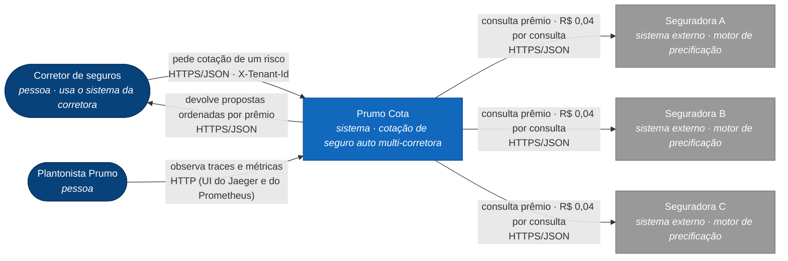
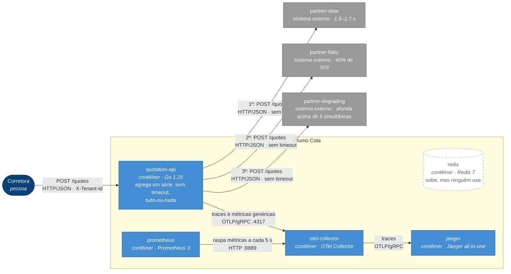
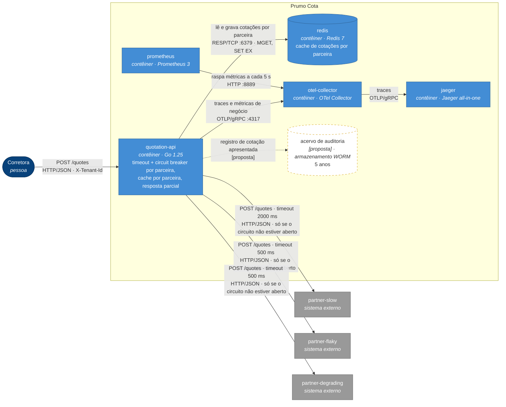
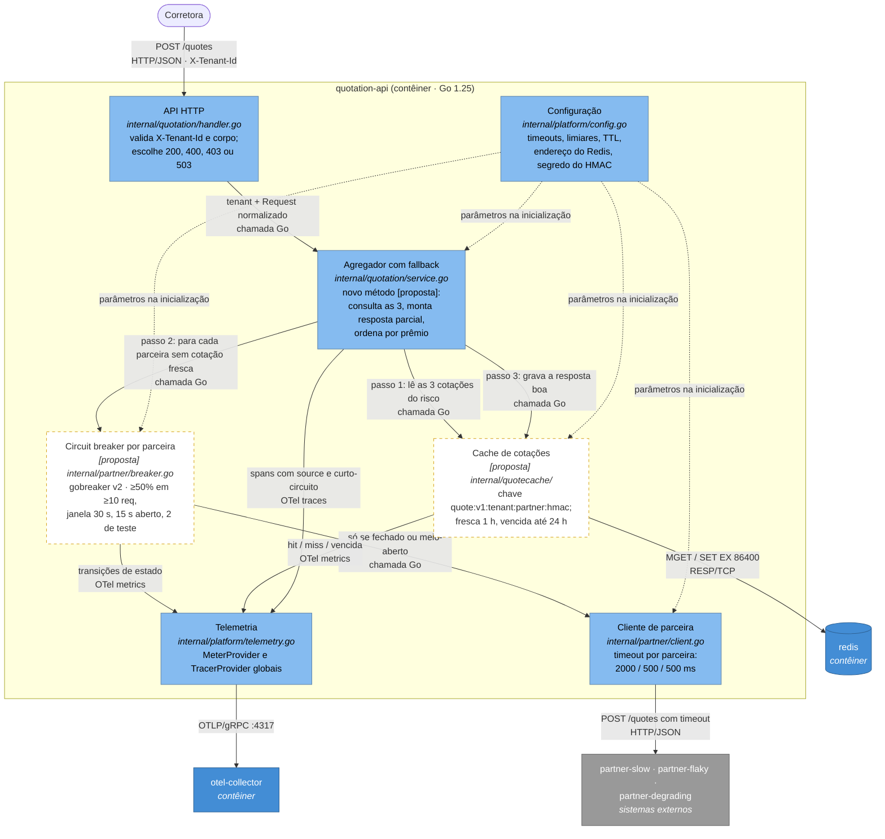

# SAD — Prumo Cota: resiliência na fronteira com as seguradoras

*Solution Architecture Document* da plataforma de cotação de seguro auto da Prumo Tecnologia em Seguros, depois da intervenção que protege a fronteira com as seguradoras parceiras.

| | |
|---|---|
| **Versão** | 0.1 — seções 1 a 4 (decisões). Seções 5 a 8 entram com os números medidos do PoC. |
| **Data** | 2026-10-26 |
| **Autor** | Guilherme A. Furmankiewicz |
| **Base** | repositório deste fork, branch `development`; enunciado em [enunciado.md](enunciado.md) |
| **Evidências** | [evidencias/](evidencias/) — o "antes" está em [evidencias/antes.md](evidencias/antes.md) |

**Convenção de rastreabilidade.** Todo caminho citado existe no repositório, salvo quando marcado como **[proposta]**, que é o que será criado na Entrega 2 (PoC) ou que fica só no papel. Números sem fonte não aparecem: cada um aponta para uma medição em `docs/evidencias/`, para o enunciado ou para o código.

---

## 1. Introdução

### 1.1 Propósito

Este documento sustenta **uma decisão**: como proteger a cotação agregada do Prumo Cota contra a instabilidade das três seguradoras parceiras, usando timeout, circuit breaker, cache e fallback na fronteira com elas, e quanto isso custa e economiza.

Ele é escrito para três leitores:

| Leitor | O que procura aqui | Onde está |
|---|---|---|
| **CTO da Prumo** | se o gasto se paga e em quanto tempo | §1.5 (pressupostos), §8 |
| **Plantonista** (quem opera às 3h) | o que olhar, qual limiar, o que fazer | §4 (comportamento), §6, §7 |
| **Encarregado de dados e auditoria** | como provar à ANPD que uma corretora nunca vê o dado de outra, e à SUSEP que a cotação servida de cache é rastreável | §4.3 (chave e descarte), §4.4 (contrato), §7 |

### 1.2 Escopo

**Dentro:** a `quotation-api` e a sua **fronteira** com as seguradoras — o cliente HTTP (`internal/partner/client.go`), a agregação (`internal/quotation/service.go`), o contrato de resposta (`internal/quotation/request.go`), o cache em Redis e a instrumentação de negócio.

**Fora:** o motor de precificação das seguradoras (a Prumo não precifica), o CRM e o front-end das corretoras, cadastro de corretoras, cobrança, autenticação, e os padrões que o enunciado declara fora de escopo (retry com backoff, bulkhead, rate limiting, fila, Kubernetes). Esses aparecem neste documento só como limite ou proposta, nunca como implementação.

### 1.3 Restrições (impostas — não são escolhas deste documento)

| # | Restrição | Origem |
|---|---|---|
| R1 | Go 1.25, Docker com Compose v2, Redis como cache, OpenTelemetry com o SDK já inicializado, Mermaid nos diagramas | enunciado, "Tecnologias obrigatórias" |
| R2 | Ambiente local, sem conta em cloud e sem custo | enunciado, "Suba o ambiente" |
| R3 | Três parceiras com comportamento fixo e determinístico (`cmd/partner-mock/`), que não podem ser alteradas | enunciado, "Restrições" |
| R4 | Cobrança de R$ 0,04 por consulta à seguradora, não por venda | enunciado, "O cenário" |
| R5 | A Prumo é **operadora** de dados pessoais (LGPD); a corretora é controladora; uso cruzado entre corretoras é proibido | enunciado, "O que a regulação impõe" |
| R6 | Toda cotação apresentada é auditável por **5 anos**, sem regravação (SUSEP), inclusive a servida de cache ou de fallback | enunciado, "O que a regulação impõe" |
| R7 | Prêmio vem sempre de uma parceira ou de cache rastreável; a plataforma nunca calcula prêmio | enunciado, "Restrições" |
| R8 | As seguradoras honram o prêmio por até **24 h** (teto comercial) | enunciado, "O cenário" |
| R9 | Os testes que já vêm no repositório continuam verdes | enunciado, "Restrições" |

### 1.4 Decisões (escolhas deste documento, defendidas na §4)

Timeout por parceira (D1), biblioteca e escopo do breaker (D2, D3), política de disparo (D4), granularidade do cache (D5), TTL e política de vencimento (D6), chave do cache (D7), estratégia de fallback (D8), onde o fallback vive no código (D9), contrato da resposta degradada (D10) e, na §5, onde a plataforma roda. O estudo completo das opções está em [estudo-decisoes.md](estudo-decisoes.md).

### 1.5 Pressupostos

Cada pressuposto tem valor, origem e o que muda se ele for falso.

| # | Pressuposto | Valor | Origem | Consequência se for falso |
|---|---|---|---|---|
| **P1** | **Recotação na mesma corretora:** fração das cotações que repetem o mesmo risco (mesmo motorista, veículo e cobertura), **na mesma corretora**, em até 1 h da anterior | **40%** | Estimativa. O enunciado afirma que "o corretor recota a mesma placa várias vezes na mesma conversa", sem número. Não há dado de produção; a métrica de hit rate do cache (§4.5) é o instrumento para medi-lo. | É o hit rate da §8. Se for **10%**, a economia de consultas cai de ≈ R$ 127 mil/mês para ≈ R$ 32 mil/mês e o veredito de payback da §8 precisa ser refeito. A recotação **entre corretoras** não conta: a chave do cache tem a corretora (§4.3). |
| **P2** | **Latência das parceiras em repouso** | slow ≤ 1700 ms · flaky ≤ 200 ms · degrading ≤ 160 ms | `docker-compose.yml` e `cmd/partner-mock/behavior.go` (latência + jitter); confirmado no trace do "antes" ([evidencias/antes.md](evidencias/antes.md), evidência 3) | Os timeouts da §4.1 são derivados destes valores. Se a `partner-slow` passar de 2 s em repouso, **toda** chamada a ela estoura e o breaker dela fica aberto o tempo todo: a parceira some das respostas por decisão nossa. Os timeouts precisam ser recalibrados com o p99 real de cada parceira. |
| **P3** | **Ritmo de produção:** 120.000 cotações por dia útil concentradas em 10 h de horário comercial | ≈ 3,3 cotações/s, ou seja ≈ 3,3 chamadas/s por parceira sem cache | Volume do enunciado ("O cenário"); a janela de 10 h é estimativa | Dimensiona a janela do breaker (§4.2): com 3,3 chamadas/s, o mínimo de 10 requisições é atingido em ≈ 3 s. Se o tráfego for muito mais espalhado (24 h), o mínimo demora mais para ser atingido e o breaker reage mais devagar. |
| **P4** | **Validade comercial do prêmio** | 24 h | Enunciado (R8) | A cotação vencida servida no fallback (§4.3, até 24 h) passaria a ser preço não honrado. A janela de vencida teria de cair para o `valid_for_seconds` devolvido pela parceira (300 s no mock). |

---

## 2. Visão geral da arquitetura

### 2.1 Contexto (C4 nível 1)

A Prumo **intermedeia**: recebe o pedido da corretora, consulta as seguradoras e devolve as propostas. Ela não precifica.



No ambiente deste repositório, as seguradoras A, B e C são os contêineres `partner-slow`, `partner-flaky` e `partner-degrading` (`cmd/partner-mock/`).

### 2.2 Contêineres — antes (C4 nível 2)

Como o sistema está no commit de partida, conforme `docker-compose.yml`.



O que o diagrama mostra, e que foi medido ([evidencias/antes.md](evidencias/antes.md)): a latência é a **soma** das três (trace de 8,05 s, dos quais 6,1 s na `partner-degrading`), e uma falha da `partner-flaky` derruba a cotação inteira (502, com o span da `partner-degrading` ausente).

### 2.3 Contêineres — depois (C4 nível 2)



### 2.4 O delta

| Tipo | O que muda | Onde |
|---|---|---|
| **Acrescenta** | timeout por parceira | `internal/partner/client.go` e `internal/platform/config.go` |
| **Acrescenta** | circuit breaker por parceira (gobreaker v2) | **[proposta]** `internal/partner/breaker.go` |
| **Acrescenta** | cache por parceira em Redis | **[proposta]** pacote novo `internal/quotecache/` |
| **Acrescenta** | resposta parcial e campos de degradação no contrato | `internal/quotation/service.go`, `internal/quotation/request.go`, `internal/quotation/handler.go` |
| **Acrescenta** | métricas e marcações de trace de negócio | **[proposta]** junto do breaker e do cache |
| **Muda de papel** | o `redis` deixa de ser um contêiner ocioso e passa a ser dependência da API (não obrigatória: sem ele, a API funciona sem cache) | `docker-compose.yml`, `cmd/quotation-api/main.go` |
| **Muda de papel** | a resposta deixa de ser tudo-ou-nada: 502 só sai do caminho antigo, que fica preservado para os testes originais | `internal/quotation/service.go` |
| **Fica no papel** | acervo de auditoria de 5 anos | **[proposta]** — custo na §8, sem código (fora de escopo pelo enunciado) |
| **Não sai nada** | o Collector, o Jaeger, o Prometheus e as três parceiras continuam como estão | — |

**A quem esta arquitetura serve.** À corretora, que deixa de receber 502 quando uma das três parceiras falha e passa a receber o que existe, sabendo o que faltou. Ao CTO, porque cada consulta que o cache evita é R$ 0,04 a menos, e cada cotação que não morre no meio deixa de desperdiçar as consultas já pagas. Ao plantonista, que passa a ver o estado de cada parceira em vez de deduzi-lo de 502 genéricos. E ao encarregado de dados, porque o isolamento entre corretoras deixa de depender de cuidado e passa a estar na chave do cache.

---

## 3. Requisitos

### 3.1 Funcionais

Os RF-01 a RF-04 saem do contrato que já existe; os RF-05 a RF-09 são **criados por esta arquitetura**. Cada um é uma frase testável.

| ID | Requisito | Origem | Como se testa |
|---|---|---|---|
| RF-01 | `POST /quotes` sem o cabeçalho `X-Tenant-Id` responde **400** `{"error":"X-Tenant-Id is required"}`; com corretora fora de `TENANTS`, **403** `{"error":"broker not enabled on this platform"}`. | contrato atual, `internal/quotation/handler.go` | `internal/quotation/handler_test.go` |
| RF-02 | A resposta de sucesso lista as cotações **ordenadas por `premium_cents` crescente**, inclusive quando é degradada. | contrato atual, `internal/quotation/service.go`; enunciado, "Outras regras" | teste de serviço com prêmios fora de ordem e uma parceira ausente |
| RF-03 | O corpo inválido responde **400** com as mensagens de `Request.Normalize()`. | contrato atual, `internal/quotation/request.go` | `internal/quotation/request_test.go` |
| RF-04 | Toda cotação apresentada carrega a parceira, o prêmio, a corretora (`tenant_id`) e o `quote_id` **original** da parceira, inclusive quando vem do cache. | R6 (SUSEP) | teste de cache: a cotação servida tem o mesmo `quote_id` da gravada |
| RF-05 | Quando uma parceira falha (erro, timeout ou circuito aberto) e as outras respondem, a API responde **200** com as cotações disponíveis, `"degraded": true` e a parceira ausente em `missing_partners`, com o motivo. | **nova** (D8) | teste de serviço com uma parceira falhando |
| RF-06 | Uma cotação servida do cache vem com `"source": "cache"` e `age_seconds` (idade desde a consulta original); uma consultada agora vem com `"source": "partner"`. | **nova** (D6, D10) | teste de cache |
| RF-07 | Com o circuito de uma parceira **aberto**, a API **não faz** a chamada HTTP a ela; a parceira aparece em `missing_partners` com o motivo `circuit_open`, ou é preenchida pela cotação vencida do cache. | **nova** (D3, D4) | teste do breaker: o servidor falso não recebe chamada com o circuito aberto |
| RF-08 | Se nenhuma parceira responder e não houver cotação no cache, a API responde **503** `{"error":"no partner insurer available","missing_partners":[...]}`, distinto do 502 atual. | **nova** (D8) | teste de serviço com as três falhando e cache vazio |
| RF-09 | Uma cotação gravada para uma corretora **nunca** é servida a outra, mesmo com corpo idêntico. | **nova** (D7); R5 | teste com duas corretoras e o mesmo corpo: a segunda é *miss* |

### 3.2 Não funcionais

O "hoje" das linhas RNF-01, RNF-02, RNF-03 e RNF-04 foi medido com `make down && make reproduce` em 2026-10-26 ([evidencias/antes.md](evidencias/antes.md)). Todas as medições usam a carga padrão: 10 requisições de baseline e 200 com 50 em voo.

| ID | Requisito | Métrica | Hoje | Alvo | Como medir | Por que este número |
|---|---|---|---|---|---|---|
| RNF-01 | Latência da cotação sob carga | p95 do `POST /quotes`, fase de carga | **8,01 s** | **≤ 3,0 s** | relatório do `make reproduce`; em gráfico: `histogram_quantile(0.95, sum by (le) (rate(http_server_request_duration_seconds_bucket{http_route="/quotes"}[5m])))` | É o **teto estrutural** da agregação em série com os timeouts da §4.1: 2,0 + 0,5 + 0,5 s. Nenhuma requisição deveria passar disso, com ou sem cache. |
| RNF-02 | Cotações entregues | fração de respostas **200** (completas ou degradadas) na fase de carga | **60%** (120 de 200) | **≥ 99%** | relatório do `make reproduce` (`success`) | Com resposta parcial, só falha quando as três parceiras falham juntas e não há cache. A `partner-slow` nunca falha em repouso (P2), então esse caso é raro. |
| RNF-03 | Consultas compradas por cotação entregue | `sum(http_client_request_duration_seconds_count) / sum(http_server_request_duration_seconds_count{http_route="/quotes", http_response_status_code="200"})` | **4,36** (545 consultas para 125 entregues) | **≤ 1,8** em produção | consulta PromQL ao lado, no fim de cada execução | 3 consultas × (1 − 40% de hit rate do P1) = 1,8. O "hoje" acima de 3 é o desperdício do tudo-ou-nada: as consultas feitas antes de uma falha são pagas e jogadas fora. |
| RNF-04 | Vazão sob 50 em voo | requisições por segundo na fase de carga | **8,0 req/s** | **≥ 16 req/s** | relatório do `make reproduce` (`throughput`) | Lei de Little com 50 em voo e o teto de 3,0 s da RNF-01: 50 ÷ 3,0 ≈ 16,7 req/s. |
| RNF-05 | Custo de uma parceira com circuito aberto | chamadas HTTP feitas a uma parceira enquanto o circuito dela está aberto | não existe breaker | **0** | trace da requisição curto-circuitada **sem** span `HTTP POST` para aquela parceira (evidência 3 da Entrega 2) | Aberto quer dizer que a chamada não sai (enunciado, Entrega 2 §1). Uma chamada feita e descartada não economiza os R$ 0,04 nem o tempo. |
| RNF-06 | Isolamento entre corretoras | respostas servidas do cache a uma corretora diferente da que gerou a entrada | 0 (não há cache) | **0**, sempre | teste determinístico do RF-09; inspeção do formato da chave (§4.3) | R5: uma resposta cruzada é incidente de dados pessoais com dever de notificação à ANPD. Não existe tolerância. |
| RNF-07 | Prazo máximo de guarda no cache | maior TTL restante de uma chave `quote:*` no Redis | não há cache | **≤ 86.400 s** (24 h) | `redis-cli --scan --pattern 'quote:*'` seguido de `TTL` em cada chave | P4 e LGPD: nada fica guardado além do teto comercial. O descarte é feito pelo próprio Redis, não por rotina manual. |

---

## 4. Detalhamento da arquitetura

Cada decisão está no formato **contexto → opções → escolha → consequências**. As opções foram estudadas em [estudo-decisoes.md](estudo-decisoes.md), que traz as tabelas completas de prós e contras.

### 4.1 Timeout por parceira (D1)

**Contexto.** O `http.Client` em `internal/partner/client.go` tem `Timeout` zero: a API espera o que a parceira quiser. A `partner-degrading` nunca falha, ela afunda: 120 ms em repouso, +300 ms por chamada simultânea acima de 5, até +6000 ms (`docker-compose.yml`). No "antes", ela levou **6149 ms** em uma única chamada ([evidencias/antes.md](evidencias/antes.md)). Sem teto de espera, essa lentidão nunca vira sinal para o breaker.

**Opções.** (a) um timeout único de 2 s; (b) um timeout único abaixo de 1,7 s; (c) um timeout por parceira, derivado de uma regra.

**Escolha: (c).** Regra: **latência máxima em repouso (P2) + 300 ms, arredondada para cima ao próximo múltiplo de 500 ms.**

| Parceira | Máxima em repouso (P2) | + 300 ms | **Timeout** | Estoura quando |
|---|---|---|---|---|
| `partner-slow` | 1700 ms | 2000 ms | **2000 ms** | a parceira ficar ≥ 300 ms mais lenta que o normal |
| `partner-flaky` | 200 ms | 500 ms | **500 ms** | idem |
| `partner-degrading` | 160 ms | 460 ms | **500 ms** | a partir de **7** chamadas simultâneas (120 + 40 + 300 × 2 = 760 ms) |
| **Soma em série** | | | **3000 ms** | teto estrutural da RNF-01 |

**O estouro conta como falha para o breaker.** Cancelamento pelo **cliente** (a corretora desistiu da requisição) **não** conta: não é a parceira que falhou.

**Descartadas.** (a) deixa a `partner-degrading` acumular até 11 chamadas simultâneas antes de estourar (120 + 300 × 6 ≈ 1,9 s) e põe o teto da cotação em 6 s. (b) mata a `partner-slow` em 100% das chamadas, porque ela leva de 1,5 a 1,7 s sempre: o breaker dela abriria e nunca mais fecharia.

**Consequências.**
- Boa: a degradação da `partner-degrading` vira falha contável logo depois do joelho de 5 simultâneas; a cotação nunca passa de ~3 s.
- Ruim: três números para manter, e todos dependem do P2. Se a latência real de uma parceira mudar, o timeout dela fica errado. A regra (e não os números) é o que se revisa.
- Ruim: com a `partner-degrading` perto do limite de 7 simultâneas, o breaker dela tende a abrir e fechar com frequência. Isso precisa de alerta (§6).

### 4.2 Circuit breaker (D2, D3, D4)

**Contexto.** O enunciado exige os três estados visíveis de fora e que **aberto signifique que a chamada não sai** (Entrega 2 §1). O `cmd/partner-mock/feasibility_test.go` já provou que, com os defaults, uma política de 50% de falha em janela de 10 abre na requisição **10** e volta a fechar **6** vezes em 210 requisições ([smoke-test-factibilidade.md](smoke-test-factibilidade.md) §2.1).

#### Biblioteca (D2)

**Opções.** (a) `github.com/sony/gobreaker/v2`; (b) `failsafe-go`; (c) implementação própria.

**Escolha: (a) `sony/gobreaker` v2.** Os três estados são constantes nomeadas (`StateClosed`, `StateHalfOpen`, `StateOpen`); o callback `OnStateChange` dá a métrica de transição sem código extra; `IsSuccessful` permite classificar o erro (timeout é falha, cancelamento do cliente não é); `ReadyToTrip` recebe os contadores e permite a política por taxa.

**Descartadas.** (b) traz retry, bulkhead e rate limiter, que são padrões fora de escopo, e a defesa ficaria mais longa sem ganho para este caso. (c) reescreve o que o próprio `feasibility_test.go` já simula e aumenta o código a defender.

**Consequência ruim.** O gobreaker não aceita relógio injetado. O teste do breaker **abrindo** é determinístico (não depende de tempo), mas a passagem de aberto para meio-aberto depende do relógio real. O meio-aberto será provado pela evidência de gráfico do estado no tempo, não por teste unitário.

#### Escopo (D3)

**Opções.** (a) um breaker por parceira; (b) um por par (parceira, corretora); (c) um global.

**Escolha: (a) um por parceira.** A falha é do **motor de precificação** da seguradora, que é um só para todas as corretoras. As condições comerciais mudam por corretora; a disponibilidade, não.

**Descartadas.** (b) com centenas de corretoras em produção, cada breaker teria pouco tráfego e demoraria a juntar o mínimo de requisições; uma parceira fora do ar seria descoberta separadamente por cada corretora, e cada uma pagaria as consultas até o seu circuito abrir. (c) uma parceira afundada derrubaria as três.

**Consequência ruim.** Uma corretora que gera muito tráfego ruim pode abrir o circuito para todas (limite L4, §4.7).

#### Política e parâmetros (D4)

| Parâmetro | Valor | Defesa |
|---|---|---|
| **Abre quando** | **≥ 50% de falha, com no mínimo 10 requisições** contadas | Validado pelo `feasibility_test.go`: abre na requisição 10, na rajada das sequências 49 a 57, e não no ruído normal de 40% da `partner-flaky`. Por ser proporção e não ordem, resiste à concorrência: sob 34 simultâneas a rajada cai de 9 para 5 seguidas, e uma regra de "5 consecutivas" passaria a abrir só na requisição 104 (smoke §2.3). |
| **Janela do estado fechado** (`Interval`) | **30 s** | Com o ritmo de produção do P3 (≈ 3,3 chamadas/s por parceira), 30 s juntam ≈ 100 chamadas, bem acima do mínimo de 10. Mais curta, poderia não juntar o mínimo; mais longa, falhas antigas pesariam no presente. |
| **Tempo aberto** (`Timeout`) | **15 s** | Precisa ser maior que o intervalo de exportação de métricas (10 s, `internal/platform/telemetry.go`) para que o estado aberto apareça na série temporal. É também maior que o maior timeout (2 s): quando o meio-aberto testa, as chamadas que estavam em voo já terminaram e a `partner-degrading` já se esvaziou. Em produção (P3), 15 s aberto evitam ≈ 50 consultas pagas a uma parceira que está falhando. |
| **Meio-aberto** (`MaxRequests`) | **2** requisições de teste; 2 sucessos fecham, 1 falha reabre | Com 40% de falha da `partner-flaky`, a chance de 2 sucessos seguidos é 36%; de 3, 21,6%. O smoke validou 2 sucessos com 6 voltas a fechado em 210 requisições, o que torna o ciclo completo observável. |
| **O que conta como falha** | erro de rede, **timeout** (D1), HTTP ≥ 500, resposta ilegível | O que indica que a parceira não está saudável. |
| **O que não conta** | cancelamento pelo cliente; HTTP 4xx | Cancelamento é decisão da corretora; 4xx indica pedido nosso inválido, não indisponibilidade da parceira. |

**Comportamento observável de cada estado:**

| Estado | A parceira é chamada? | O que a corretora vê |
|---|---|---|
| **Fechado** | sim, com o timeout da §4.1 | resposta normal da parceira (`source: partner`) |
| **Aberto** | **não** | cotação vencida do cache, se houver (`source: cache`, com idade); senão a parceira em `missing_partners` com `circuit_open` |
| **Meio-aberto** | só as 2 requisições de teste; as demais seguem como no aberto | como no fechado, para as de teste |

### 4.3 Cache (D5, D6, D7)

#### Granularidade (D5)

**Opções.** (a) uma entrada por parceira e risco; (b) uma entrada por risco com a cotação agregada.

**Escolha: (a) por parceira.** Com a `partner-flaky` falhando 40% das vezes, um cache agregado só seria gravado quando as três respondessem, e cerca de 40% das cotações nunca entrariam nele. Por parceira, as respostas boas entram sempre, e a cotação de uma parceira pode ser usada quando só ela falhar.

**Consequências.** Boa: o cache sobrevive a uma parceira fora do ar por horas (cenário (b) da §7). Ruim: a mesma resposta pode misturar cotações de idades diferentes; por isso a idade vai **em cada cotação** (D10). São 3 leituras por requisição, feitas em um único `MGET`.

#### TTL e política de vencimento (D6)

**Opções.** (a) 300 s, o `valid_for_seconds` do mock; (b) entre 15 min e 1 h; (c) 24 h, o teto comercial.

**Escolha: (b), com dois prazos.**

| Prazo | Valor | O que acontece |
|---|---|---|
| **Fresca** | idade < **1 h** | servida normalmente, sem chamar a parceira (`source: cache`, `age_seconds`) |
| **Vencida** | idade entre 1 h e 24 h | **só** é servida se a parceira falhar (erro, timeout ou circuito aberto); marcada com a idade; a resposta inteira sai com `degraded: true` |
| **Descarte** | **24 h** | a entrada é gravada com `SET ... EX 86400`; o Redis a apaga sozinho (RNF-07) |

**Defesa do 1 h.** É a duração de uma conversa de venda, em que o corretor recota a mesma placa várias vezes (enunciado, "O cenário"). Esse é o P1: 40% de recotação **na mesma corretora** em até 1 h, que é o hit rate da §8. O 1 h fica bem abaixo do teto comercial de 24 h (R8), o que limita o risco de exibir preço que a seguradora já mudou.

**Defesa da vencida até 24 h.** Na falha, uma cotação de 3 h atrás, identificada como tal, é mais útil para a corretora do que nenhuma, e a seguradora ainda a honra (P4). Fora da falha, ela nunca é servida.

**Descartadas.** (a) 300 s pega só a recotação dentro de 5 minutos e reduz a economia da §8 a uma fração; o enunciado deixa claro que esse é o TTL técnico do mock, não o de negócio. (c) 24 h apresenta como normal uma cotação de quase um dia, sem margem nenhuma até o teto.

**Invalidação antes da hora:**

| Mecanismo | Quando | Situação |
|---|---|---|
| TTL (fresca 1 h, descarte 24 h) | sempre | implementado |
| **Versão na chave** (`v1`) | mudança do formato da cotação ou da tabela de preço | implementado: trocar a versão faz todo o cache antigo deixar de ser lido; o TTL limpa o resto em até 24 h |
| Apagar por corretora | corretora deixa a plataforma ou pede eliminação de dados | **[proposta]**: o `tenant_id` é o terceiro segmento da chave, então `SCAN` com o padrão `quote:v1:{tenant_id}:*` seguido de `DEL` resolve, sem código novo na API |

**Consequência ruim.** O TTL é a única invalidação automática: se uma seguradora mudar o preço no meio da hora, a corretora vê o preço antigo até a entrada vencer (limite L3, §4.7).

#### Chave (D7)

**A chave, por extenso:**

```text
quote:v1:{tenant_id}:{partner}:{hmac}
```

| Segmento | Conteúdo | Exemplo |
|---|---|---|
| `quote` | espaço de nomes | `quote` |
| `v1` | versão do formato (invalidação em massa) | `v1` |
| `{tenant_id}` | a corretora, lida do cabeçalho `X-Tenant-Id` **já validado** contra `TENANTS` | `corretora-a` |
| `{partner}` | o nome da parceira, como em `PARTNER_ENDPOINTS` | `partner-flaky` |
| `{hmac}` | HMAC-SHA256, em hexadecimal, dos campos do risco **depois** de `Request.Normalize()`, separados por `\|`: `driver.document`, `driver.birth_year`, `vehicle.plate`, `vehicle.model`, `vehicle.year`, `vehicle.value_cents`, `coverage` | `9f2c…` (64 caracteres) |

Exemplo completo: `quote:v1:corretora-a:partner-flaky:9f2c…e41a`.

**Por que cada parte.**
- **`tenant_id` na chave** é o contrato de isolamento (R5, RNF-06). Ele vem do **cabeçalho**, não do corpo: o corpo não tem a corretora (enunciado, "Dicas finais"). O próprio mock confirma a necessidade: o prêmio é um hash do corpo enviado à parceira, que inclui a corretora (`cmd/partner-mock/behavior.go`), então a mesma placa custa diferente para corretoras diferentes.
- **Todos os campos que mudam o prêmio**, não só a placa: dois motoristas com o mesmo carro, ou o mesmo motorista com outra cobertura, são riscos diferentes.
- **Normalizados** por `Request.Normalize()` (placa em maiúsculas, espaços removidos, cobertura padrão): `abc1d23` e `ABC1D23` são o mesmo risco.
- **HMAC em vez de texto aberto:** CPF e placa não aparecem em nenhuma ferramenta que liste chaves do Redis. Um SHA-256 simples seria reversível por força bruta, porque o CPF tem poucos dígitos; o HMAC com um segredo da plataforma não é. O segredo vem de variável de ambiente.

**Valor da entrada:** a cotação da parceira como ela chegou (`partner`, `quote_id`, `premium_cents`, `currency`, `coverage_cents`, `valid_for_seconds`) mais `cached_at`. Não contém CPF nem placa.

**Se o Redis cair:** a leitura é tratada como *miss* e a gravação é ignorada. A cotação continua funcionando, só sem cache (cenário (a) da §7).

### 4.4 Fallback e contrato da resposta (D8, D9, D10)

#### Estratégia (D8)

**Opções.** (a) resposta parcial; (b) cotação anterior do cache; (c) recusa explícita.

**Escolha: (a) resposta parcial.** A corretora recebe as cotações das parceiras disponíveis e a lista explícita das que faltaram, com o motivo.

Na falha de uma parceira, a **política de cache** (§4.3) pode preencher o lugar dela com a cotação vencida, marcada com a idade. Isso não é uma segunda estratégia: é a política de vencimento do cache agindo dentro da resposta parcial. Quando **nada** está disponível (nenhuma parceira respondeu e não há cache), a resposta parcial ficaria vazia; esse é o único caso de recusa, com o **503** do RF-08.

**Defesa.** É a única opção que melhora as duas pontas medidas no "antes": a taxa de sucesso (60%, RNF-02) e o desperdício de consultas (4,36 por cotação entregue, RNF-03). As consultas feitas antes de uma falha deixam de ser jogadas fora.

**Descartadas.** (b) depende de cache: a primeira cotação de um risco nunca teria fallback. (c) troca o 502 genérico por um erro claro, mas mantém a taxa de sucesso e o desperdício como estão.

**Consequências ruins.** A proposta mais barata pode estar justamente na parceira que faltou, e a corretora pode vender a segunda mais barata sem saber. Por isso `missing_partners` é obrigatório na resposta degradada: a corretora decide se recota.

#### Onde vive no código (D9)

**Contexto.** O teste original `TestOnePartnerDownBringsDownTheWholeRequest` (`internal/quotation/service_test.go`) exige que `Service.Quote` devolva erro quando uma parceira falha, e a regra R9 proíbe quebrá-lo.

**Escolha.** `Service.Quote` fica como está. Um **novo método** em `internal/quotation/service.go` **[proposta]** faz a agregação com cache e resposta parcial, e é ele que o handler passa a usar. Os testes originais continuam testando o comportamento original, que continua existindo.

**Descartadas.** Mudar `Service.Quote` e o teste viola R9. Um tipo novo em outro pacote afastaria o fallback do `service.go`, que é onde o enunciado o espera.

**Consequência ruim.** `Service.Quote` passa a ser usado só pelos testes. Isso é declarado no README do processo.

#### Contrato da resposta (D10)

**Escolha.** Campos **acrescentados** ao `Response` de `internal/quotation/request.go`, sem remover nenhum. Um cliente que ignore campos novos continua funcionando.

| Campo | Onde | Significado |
|---|---|---|
| `degraded` | resposta | `true` se alguma parceira faltou **ou** se alguma cotação é vencida |
| `missing_partners` | resposta | lista de `{partner, reason}`; `reason` ∈ `circuit_open`, `timeout`, `partner_error` |
| `source` | cada cotação | `partner` (consultada agora) ou `cache` |
| `age_seconds` | cada cotação | idade desde a consulta original; 0 quando `source` é `partner` |
| `stale` | cada cotação | `true` se a cotação passou de 1 h e só foi servida por causa de uma falha |

Exemplo de resposta degradada, com a `partner-flaky` com circuito aberto e sem cotação no cache:

```json
{
  "tenant_id": "corretora-a",
  "degraded": true,
  "quotes": [
    {
      "partner": "partner-degrading",
      "quote_id": "partner-degrading-6c1e0b7a9f3d2e14",
      "premium_cents": 71230,
      "currency": "BRL",
      "coverage_cents": 5000000,
      "valid_for_seconds": 300,
      "source": "partner",
      "age_seconds": 0,
      "stale": false
    },
    {
      "partner": "partner-slow",
      "quote_id": "partner-slow-0a4f9c2b7e1d3f88",
      "premium_cents": 118400,
      "currency": "BRL",
      "coverage_cents": 6000000,
      "valid_for_seconds": 300,
      "source": "cache",
      "age_seconds": 742,
      "stale": false
    }
  ],
  "missing_partners": [
    { "partner": "partner-flaky", "reason": "circuit_open" }
  ],
  "elapsed_ms": 4
}
```

Os valores são ilustrativos. A ordenação por `premium_cents` crescente se mantém (RF-02).

**Rastreabilidade (R6).** Uma cotação servida do cache carrega o `quote_id` **original** da parceira e a sua idade: o registro de auditoria **[proposta]** consegue ligá-la à consulta que a originou. Cada cotação apresentada, de cache ou não, gera um registro (corretora, parceira, `quote_id`, prêmio, instante de apresentação, `source`, idade). A persistência desse registro está fora do escopo do PoC (enunciado, "Fora de escopo") e tem o custo calculado na §8.

### 4.5 O que fica observável

A instrumentação é o método de prova das decisões acima (enunciado, Entrega 2 §4). Nomes de métrica e atributos são definidos na implementação e declarados no README do processo; aqui fica **o que** precisa ser observável e por quê.

| O que | Para provar | Atributos permitidos |
|---|---|---|
| Estado atual e transições do breaker, por parceira | §4.2: o degrau fechado → aberto → meio-aberto → fechado | `partner`, estado de origem e de destino |
| *Hit*, *miss* e uso de vencida no cache, por parceira | §4.3 e P1: o hit rate em PromQL, que valida o pressuposto em produção | `partner`, resultado |
| Latência por parceira | §4.1: quem é lenta e quem é instável | `partner` (ou `server_address`, se for reaproveitada `http_client_request_duration_seconds`) |
| Requisição curto-circuitada, no trace | RNF-05: sem ela, a requisição aparece como uma cotação misteriosamente rápida | `partner`, estado do breaker |
| Resposta servida de cache, no trace | RF-06: a cotação sem span de saída para a parceira | `partner`, `source` |

**Nunca** entram em atributo de span ou de métrica: CPF, placa, `quote_id` (dado pessoal e cardinalidade sem teto). O `tenant_id` pode entrar onde for útil, mas **não** como rótulo das métricas do breaker, porque o escopo do breaker é por parceira.

### 4.6 Componentes da fatia implementada (C4 nível 3)

Dentro do contêiner `quotation-api`.



**Fluxo por parceira, dentro do agregador:**

1. Há cotação **fresca** no cache? → usa (`source: cache`). A parceira **não** é chamada.
2. O circuito da parceira está **aberto**? → não chama. Há cotação **vencida** (até 24 h)? → usa, com `stale: true`. Senão → `missing_partners` com `circuit_open`.
3. Chama a parceira pelo breaker, com o timeout dela. Sucesso → usa (`source: partner`) e grava no cache.
4. Falhou (timeout ou erro)? → há cotação vencida? → usa, com `stale: true`. Senão → `missing_partners` com `timeout` ou `partner_error`.

Depois das três: se há ao menos uma cotação, responde **200** ordenado por prêmio (com `degraded` quando faltou algo); se não há nenhuma, **503** (RF-08).

### 4.7 Limites conhecidos

O que esta arquitetura **não** resolve. Nenhum destes é para implementar; declarar a fronteira faz parte da arquitetura.

| # | Limite | Gatilho que o expõe | Efeito na corretora |
|---|---|---|---|
| **L1** | **Sem limite de chamadas simultâneas por parceira.** O timeout corta a espera, mas não impede que a API abra muitas chamadas ao mesmo tempo. | Cache frio com carga alta: na primeira rodada da carga padrão, as 50 requisições chegam juntas com o cache vazio e vão todas às parceiras. A `partner-degrading` passa de 7 simultâneas, estoura o timeout e o circuito dela abre. | Nos primeiros segundos depois de um deploy ou de uma perda do Redis, a `partner-degrading` falta em várias cotações (`missing_partners: timeout`, depois `circuit_open`), até o cache aquecer e o breaker fechar. |
| **L2** | **O breaker vive na memória do processo** e não atravessa réplicas. | Mais de uma réplica da `quotation-api`, ou um reinício do processo. | Com N réplicas, cada uma descobre sozinha que a parceira caiu: até N × 10 chamadas pagas antes de todas abrirem. Depois de um reinício, o circuito volta fechado e a parceira ruim é chamada de novo. |
| **L3** | **O TTL é a única forma automática de invalidar o cache.** | A seguradora muda o preço, ou uma corretora renegocia as condições comerciais, no meio da hora. | A corretora vê o preço antigo por até 1 h (fresca) e, durante uma falha da parceira, por até 24 h (vencida, mas marcada). A invalidação por corretora fica como proposta (§4.3). |
| **L4** | **Uma corretora pode consumir a capacidade das outras.** O escopo do breaker é por parceira, e não há cota por corretora. | Uma corretora com volume alto, ou com pedidos que a parceira rejeita, gera falhas e lentidão que abrem o circuito da parceira. | **Todas** as corretoras perdem aquela parceira por 15 s a cada abertura, por causa de uma só. |

Mais um ponto que vale citar, e que não é código desta entrega (enunciado, "Fora de escopo"): duas requisições concorrentes da mesma corretora para o mesmo risco, uma servida de cache e outra da parceira, podem devolver **dois prêmios diferentes para o mesmo risco no mesmo minuto**, se a parceira tiver mudado o preço desde a gravação. Os dois são preços reais e rastreáveis; nenhum é inventado.

---

## 5. Implementação

*A escrever na fase 1B, com o mapa de cada mecanismo para o arquivo real e a decisão de hospedagem.*

## 6. Operação e gestão de mudanças

*A escrever na fase 1B, com os alertas, o runbook e o caminho de mudança do TTL.*

## 7. Recuperação de desastres

*A escrever na fase 1B, com RTO e RPO por classe de dado e os três cenários.*

## 8. Tecnologias, custos e pessoal

*A escrever na fase 1B, com a conta de parceiro por hit rate, a infraestrutura, o pessoal, o custo de auditoria e o veredito de payback.*
